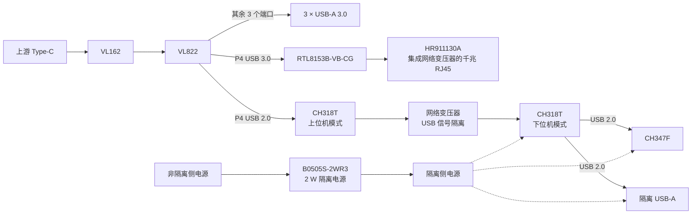

# VL822 高速加隔离拓展坞

基于 VL822 的自制四层拓展坞，完成 USB 扩展、千兆以太网与隔离调试接口的电路设计及 PCB 布局布线。通过 P4 端口的 USB 3.0 / USB 2.0 分别连接网卡与隔离支路，在同一块板上集成日常扩展接口和隔离调试接口。

## 项目概览

| 项目 | 内容 |
| --- | --- |
| 主控与上游 | VL822，Type-C 经 VL162 接入 |
| USB 扩展 | 3 路 USB-A 3.0 |
| 以太网 | RTL8153B-VB-CG，搭配 HR911130A 集成网络变压器的千兆 RJ45 |
| USB 隔离 | 两颗 CH318T，采用网络变压器耦合 |
| 隔离侧接口 | CH347F 调试接口、1 路 USB-A 2.0 |
| 隔离供电 | B0505S-2WR3，2 W 隔离电源 |
| PCB | 四层板，华秋 04161H05-7628 叠构 |
| 布线与分区 | 90 Ω / 100 Ω 差分阻抗计算，2 mm 隔离开槽 |

[功能设计](#功能设计) · [PCB 设计](#pcb-设计)

## 功能设计

### USB 3.0 扩展与千兆以太网

Type-C 上游经 VL162 接入 VL822，三个下行端口连接 USB-A 3.0。P4 的 USB 3.0 信号连接 **RTL8153B-VB-CG**，再通过 **HR911130A** 引出千兆网口，将 USB 扩展与有线网络集中到同一上游接口。

### USB 2.0 隔离扩展

P4 的 USB 2.0 信号接入上位机模式的 **CH318T**，经网络变压器耦合至隔离侧的另一颗 CH318T。下位机 CH318T 的两个 USB 2.0 下行端口分别连接 **CH347F** 和普通 USB-A，形成隔离调试与隔离外设两路接口。

### 隔离调试与供电

CH347F 的调试信号通过板右侧排针引出，与隔离 USB-A 共用隔离侧电源和地。供电采用 **B0505S-2WR3、2 W 隔离电源**，配合 USB 数据链路的变压器耦合构成隔离支路。

展开查看硬件功能框图

## PCB 设计

采用四层 PCB 完成 VL822、网卡、隔离 USB 与供电电路的布局布线。三个 USB-A 3.0 和千兆网口沿板边布置，隔离调试区集中在板右侧。

### 层叠与阻抗

使用华秋 **04161H05-7628** 层叠结构进行阻抗计算，覆盖 **90 Ω、100 Ω 差分**参数。下图给出对应的线宽、线距、参考层及介质厚度；计算结果分别约为 **89.70–90.24 Ω** 和 **100.04–100.23 Ω**。

### 布局与布线

页首与下图展示不同布线视图，可见 VL822 向 USB-A 接口的差分走线、网卡至 RJ45 的连接，以及隔离侧调试排针的信号引出。

### 隔离边界与铜皮分区

主电路区与隔离调试区之间采用 **2 mm 开槽**，隔离侧独立使用 **ISO+5V、GND_ISO** 网络。下图展示电源铜皮、隔离侧连接与开槽边界的布局关系。

USB 隔离支路使用两颗 CH318T 之间的网络变压器；HR911130A 内置的网络变压器用于以太网接口。

[CH318 技术手册](https://www.wch.cn/downloads/CH318DS1_PDF.html) · [HR911130A 产品资料](https://www.hanrun.com/rj45_1000/203.html) · [返回项目作品集](../../README.md)
