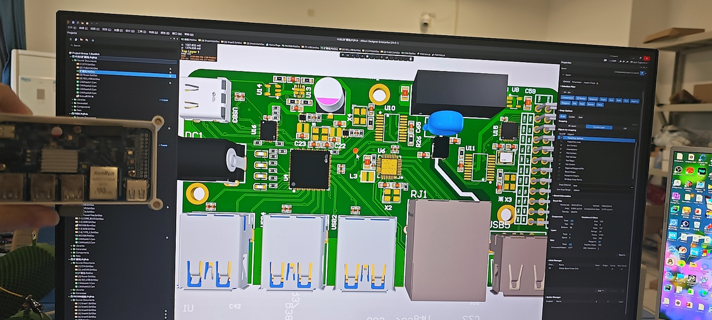
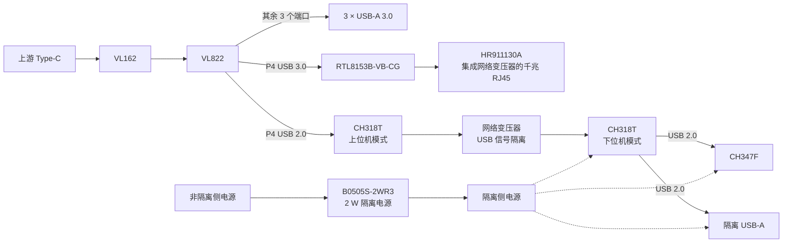
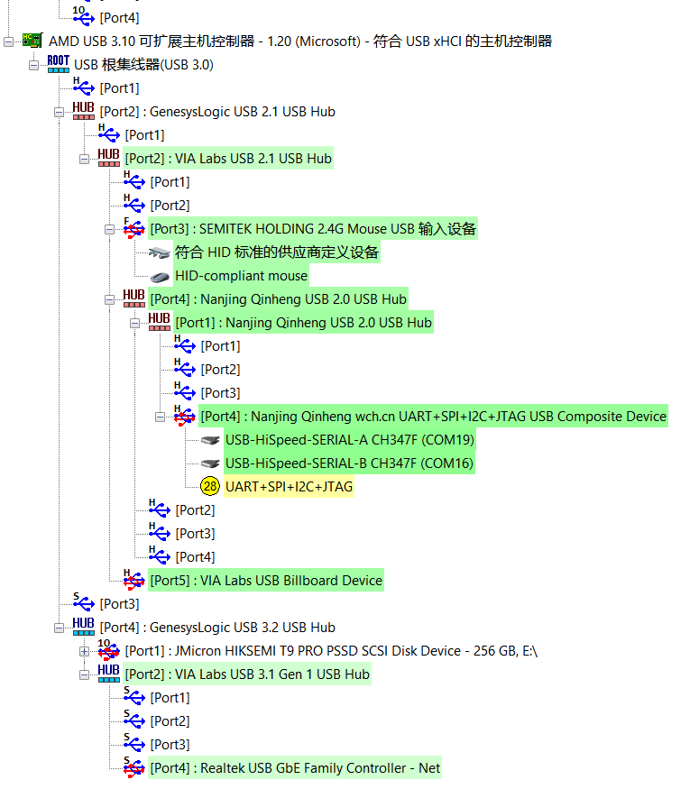
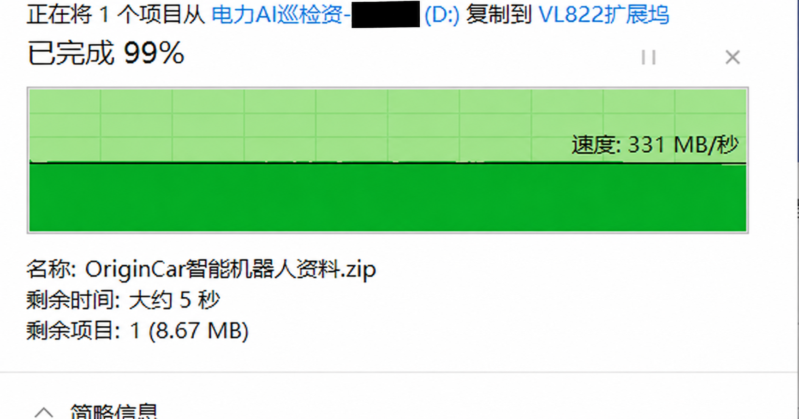
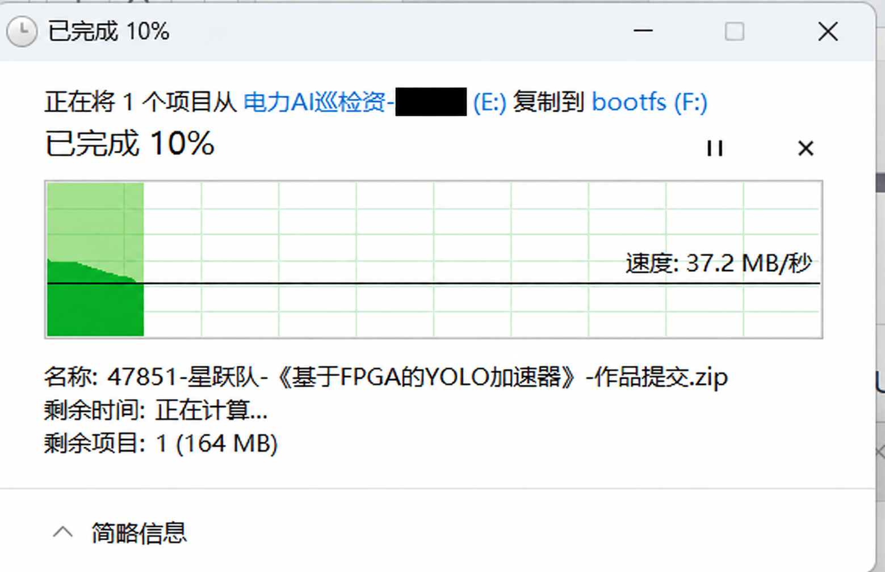
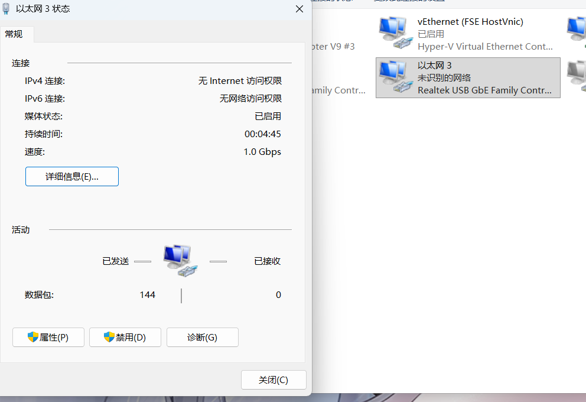

# VL822 高速加隔离拓展坞

基于 VL822 的四层拓展坞，集成 3 路 USB-A 3.0、千兆以太网、隔离 USB-A 和 CH347F 调试接口。

USB 在 5 Gbps 链路下传输稳定，文件复制约 **331 MB/s**，另有 **10 Gbps** 协商记录。隔离侧 USB-A 文件复制约 **37.2 MB/s**，网口协商速率为 **1 Gbps**。



## 项目概览

| 项目 | 配置 |
| --- | --- |
| 上游接口 | Type-C → VL162 → VL822 |
| USB 扩展 | 3 × USB-A 3.0 |
| VL822 供电 | 两颗 ETA3512FSG，分别输出 3.3 V、1.05 V |
| 网口 | RTL8153B-VB-CG + HR911130A |
| USB 隔离 | 两颗 CH318T，通过网络变压器耦合 |
| 隔离侧 | 1 × USB-A 2.0、CH347F |
| 隔离电源 | B0505S-2WR3，2 W |
| PCB | 四层板，华秋 04161H05-7628 |
| 阻抗与开槽 | 90 Ω / 100 Ω 差分，2 mm 隔离槽 |

[功能设计](#功能设计) · [板级验证](#板级验证) · [PCB 设计](#pcb-设计) · [文件下载与已知问题](#文件下载与已知问题) · [硬件踩坑记录](hardware-notes.md)

## 功能设计

### USB 扩展与网口

Type-C 经 VL162 接入 VL822，三个下行端口连接 USB-A 3.0。P4 的 USB 3.0 信号连接 RTL8153B-VB-CG，通过内置网络变压器的 HR911130A 引出千兆网口。

### 隔离 USB 与 CH347F

P4 的 USB 2.0 信号接入上位机模式的 CH318T，通过网络变压器耦合至隔离侧的下位机 CH318T。两个下行端口分别连接 USB-A 2.0 和 CH347F。

隔离侧由 2 W 的 B0505S-2WR3 供电，CH347F 的信号通过右侧排针引出。

<details>
<summary>硬件框图</summary>



</details>

## 板级验证

### USB 设备识别

USB 设备树中可见 VIA Hub、两级沁恒 Hub、Realtek 网卡和 CH347F。CH347F 双串口枚举为 **COM19、COM16**，多功能接口节点显示“28”提示。



### 10 Gbps 协商

连接 **HIKSEMI T9 PRO PSSD** 后，USB Device Tree Viewer 显示协商速率为 **SuperSpeedPlus 10 Gbps**，Rx、Tx 均为单通道 10 Gbps，端口链为 **2-4-1**。

[查看协商日志](logs/usb-10gbps-negotiation.txt)

<details>
<summary>10 Gbps 日志</summary>

```text
Port Chain               : 2-4-1
Product String           : "T9 PRO PSSD"
USB Version              : 3.2 Gen 2 (aka USB 3.1 - 10 Gbit/s)
Port maximum Speed       : SuperSpeedPlus 10 GBit/s
Device maximum Speed     : SuperSpeedPlus 10 GBit/s
Device Connection Speed  : SuperSpeedPlus 10 GBit/s
DevIsOpAtSsPlusOrHigher   : 1
-> Rx speed is 10 Gbps
-> Tx speed is 10 Gbps
```

</details>

### USB-A 文件传输

USB-A 在 5 Gbps 链路下传输稳定，文件复制速度约 **331 MB/s**。



### 隔离侧 USB-A 文件传输

隔离侧 USB-A 连接 U 盘，文件复制速度约 **37.2 MB/s**。



### 网口连接

网卡识别为 **Realtek USB GbE Family Controller**，以太网协商速率为 **1.0 Gbps**。



## PCB 设计

三个 USB-A 3.0 和网口沿板边布置，隔离 USB-A、CH347F 和调试排针集中在右侧。

### 层叠与阻抗

采用华秋 **04161H05-7628** 四层叠构，计算 **90 Ω、100 Ω 差分阻抗**。线宽、线距和参考层如下。


### 布局与布线

以下为两层布线视图，包括 USB 差分线、以太网走线和隔离侧调试信号。


### 隔离分区

主电路区与隔离区之间开 **2 mm 槽**，隔离侧使用独立的 **ISO+5V、GND_ISO**。USB 信号采用网络变压器耦合，电源由 2 W 隔离模块提供。


## 文件下载与已知问题

[下载 PCB 和原理图](hardware/vl822-dock-pcb-schematics.zip?raw=true)。文件包包含 PCB、4 张原理图、符号库和封装库，使用 Altium Designer 打开。

- USB-A 连接器选型未考虑 10 Gbps 适配，导致该速率下信号完整性裕量不足，需更换为支持 10 Gbps 的型号。
- CH347F 功能尚未验证。

[CH318 手册](https://www.wch.cn/downloads/CH318DS1_PDF.html) · [HR911130A 资料](https://www.hanrun.com/rj45_1000/203.html) · [返回项目列表](../../README.md)
