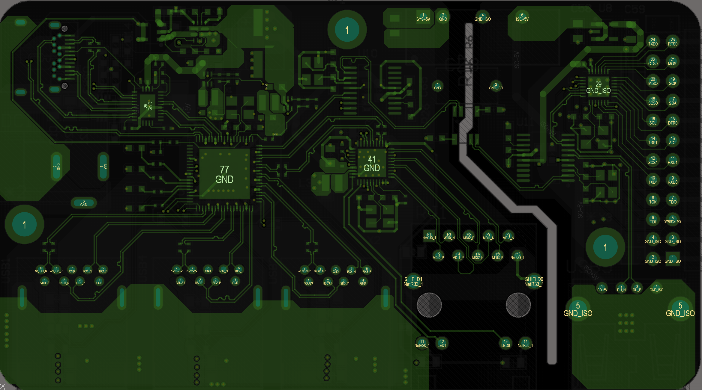
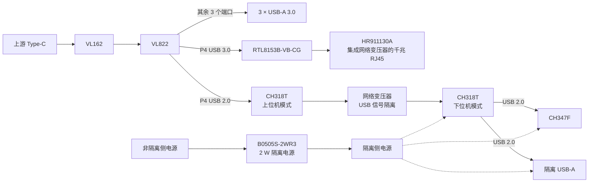
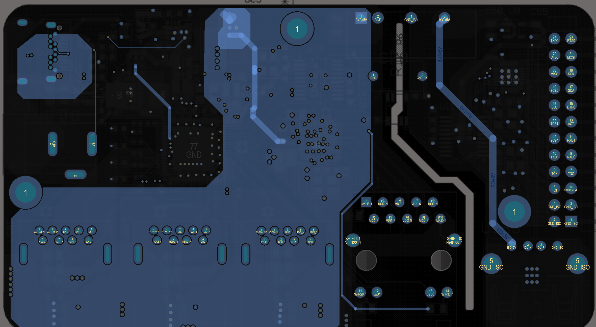
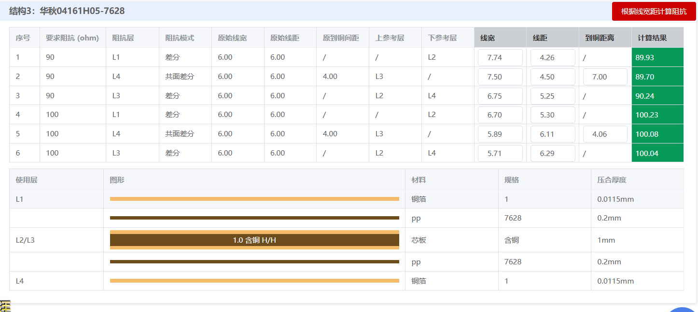
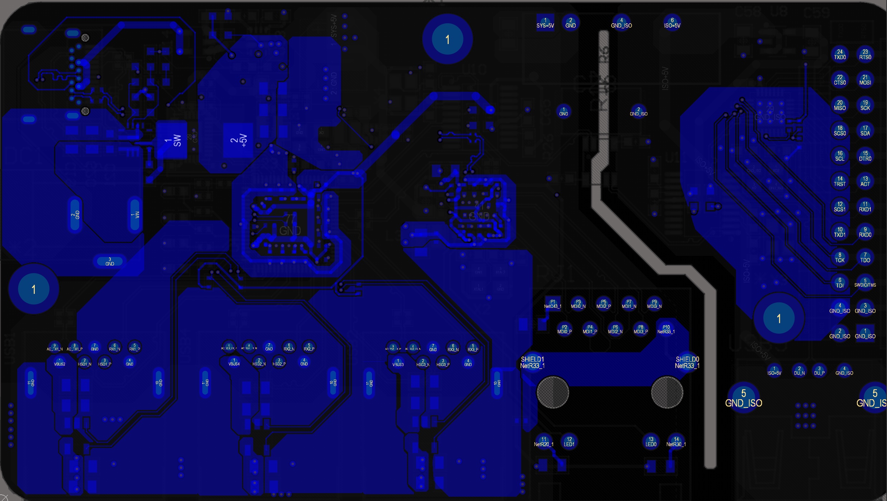

# 高速加隔离拓展坞

[返回项目作品集](../../README.md)

以 VL822 为核心，将 **3 路 USB-A 3.0、千兆以太网、隔离 USB-A 与 CH347F 调试接口**集成在四层 PCB 上。设计重点是 P4 端口的 USB 3.0 / USB 2.0 分配，以及高速接口区与隔离调试区的布局。

## 接口架构

| 功能 | 连接方案 |
| --- | --- |
| 上游接入 | Type-C → VL162 → VL822 |
| USB 扩展 | VL822 的其余三个端口 → 3 × USB-A 3.0 |
| 千兆以太网 | P4 USB 3.0 → RTL8153B-VB-CG → HR911130A 集成磁性器件网口 |
| 隔离 USB | P4 USB 2.0 → CH318T 上位机 → 网络变压器 → CH318T 下位机 |
| 隔离侧输出 | 下位机 CH318T 的两个 USB 2.0 下行口分别连接 CH347F 与 USB-A |
| 隔离侧供电 | B0505S-2WR3，2 W 隔离电源 |

展开硬件功能框图

## 隔离分区

板右侧集中布置 CH347F、调试排针和隔离 USB-A，通过 **2 mm 开槽**与主电路区分隔。USB 数据经两颗 CH318T 之间的网络变压器传输，电源经 2 W 隔离模块跨越边界，隔离侧使用独立的 ISO+5V 与 GND_ISO 网络。

HR911130A 内置的变压器用于以太网支路；两颗 CH318T 之间的变压器用于 USB 隔离支路。

## 四层 PCB 与阻抗设计

采用华秋 **04161H05-7628** 四层叠构，围绕 **90 Ω、100 Ω 差分阻抗**进行线宽、线距与参考层计算。下图记录的是阻抗计算参数与结果。

另一布线视图展示了高速接口走线、供电铜皮以及隔离侧调试信号的引出。

参考资料：[沁恒 CH318 技术手册](https://www.wch.cn/downloads/CH318DS1_PDF.html) · [汉仁 HR911130A 产品资料](https://www.hanrun.com/rj45_1000/203.html)
