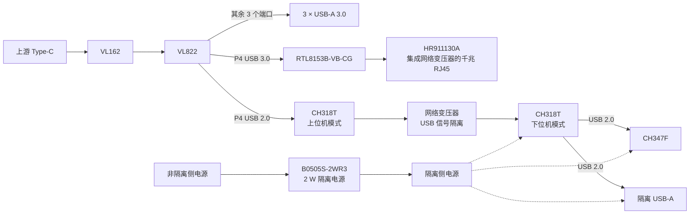

# 高速加隔离拓展坞

[返回项目作品集](../../README.md)

基于 VL822 的高速扩展坞，将 USB 3.0 扩展、千兆网口和隔离 USB 2.0 接口集成在一块板上。

## 硬件架构

- **USB 扩展：** Type-C 上游经 VL162 接入 VL822；其中三个端口用于 USB-A 3.0。P4 的 USB 3.0 与 USB 2.0 信号分别用于以太网和隔离 USB 支路。
- **以太网：** RTL8153B-VB-CG 接入 P4 的 USB 3.0 信号，连接集成网络变压器的 HR911130A 千兆网口。
- **隔离 USB：** P4 的 USB 2.0 信号接入上位机模式 CH318T，经网络变压器耦合至隔离侧的下位机模式 CH318T；其两个下行端口分别接 CH347F 和普通 USB-A。
- **隔离电源与布局：** 隔离侧由 B0505S-2WR3 供电，额定功率 2 W；隔离边界采用 2 mm 开槽。USB 信号隔离变压器与 HR911130A 内部的以太网变压器分别服务于不同支路。

上述为功能架构示意，具体引脚、外围器件和电源连接以 Altium 原理图为准。

## 设计资料

Altium 工程包含 VL822、ETH、ISO_USB 和 Power 原理图以及 PCB 文件。实物、接口测试和调试结果待补充。

参考资料：[沁恒 CH318 技术手册](https://www.wch.cn/downloads/CH318DS1_PDF.html) · [汉仁 HR911130A 产品资料](https://www.hanrun.com/rj45_1000/203.html)
