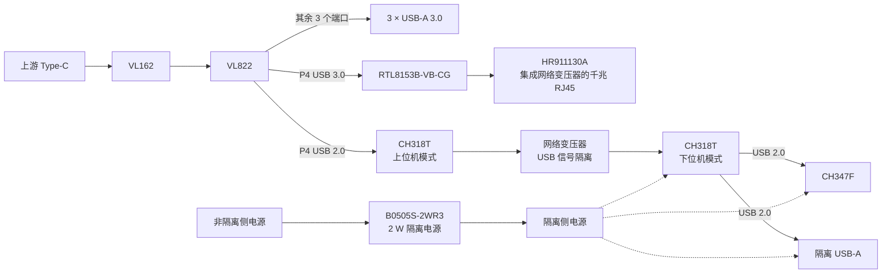

# VL822 高速加隔离拓展坞

做了一块四层拓展坞，把 3 个 USB-A 3.0、千兆网口、隔离 USB-A 和 CH347F 放在一起。普通接口用来接外设，隔离侧留给 USB 设备和调试接口。

USB 5 Gbps 下传文件比较稳定，速度约 **331 MB/s**，也协商出了 **10 Gbps**。隔离侧接 U 盘传文件约 **37.2 MB/s**，网口协商为 **1 Gbps**。


## 项目概览

| 项目 | 配置 |
| --- | --- |
| 上游接口 | Type-C → VL162 → VL822 |
| 普通 USB | 3 × USB-A 3.0 |
| 网口 | RTL8153B-VB-CG + HR911130A |
| USB 隔离 | 两颗 CH318T，中间用网络变压器耦合 |
| 隔离侧 | 1 × USB-A 2.0、CH347F |
| 隔离电源 | B0505S-2WR3，2 W |
| PCB | 四层板，华秋 04161H05-7628 |
| 阻抗与开槽 | 90 Ω / 100 Ω 差分，2 mm 隔离槽 |

[功能设计](#功能设计) · [板级验证](#板级验证) · [PCB 设计](#pcb-设计) · [文件下载与已知问题](#文件下载与已知问题)

## 功能设计

### USB 扩展与网口

Type-C 通过 VL162 接到 VL822，其中三个端口接 USB-A 3.0。P4 的 USB 3.0 接 RTL8153B-VB-CG，再接带网络变压器的 HR911130A 网口。

### 隔离 USB 与 CH347F

P4 的 USB 2.0 接上位机模式的 CH318T，通过网络变压器连到隔离侧的另一颗 CH318T。隔离侧有两个 USB 2.0 下行口，一个接普通 USB-A，另一个接 CH347F。

隔离侧由 2 W 的 B0505S-2WR3 供电，CH347F 的信号通过右侧排针引出。

<details>
<summary>硬件框图</summary>



</details>

## 板级验证

### USB 设备识别

电脑能识别出 VIA Hub、两级沁恒 Hub、Realtek 网卡和 CH347F。CH347F 的两个串口分别显示为 **COM19、COM16**，多功能接口节点还有一个“28”提示。


### 10 Gbps 协商

接上 **HIKSEMI T9 PRO PSSD** 后，USB Device Tree Viewer 显示连接速度为 **SuperSpeedPlus 10 Gbps**，Rx、Tx 都是单通道 10 Gbps，端口链为 **2-4-1**。

[查看协商日志](logs/usb-10gbps-negotiation.txt)

<details>
<summary>10 Gbps 日志</summary>

```text
Port Chain               : 2-4-1
Product String           : "T9 PRO PSSD"
USB Version              : 3.2 Gen 2 (aka USB 3.1 - 10 Gbit/s)
Port maximum Speed       : SuperSpeedPlus 10 GBit/s
Device maximum Speed     : SuperSpeedPlus 10 GBit/s
Device Connection Speed  : SuperSpeedPlus 10 GBit/s
DevIsOpAtSsPlusOrHigher   : 1
-> Rx speed is 10 Gbps
-> Tx speed is 10 Gbps
```

</details>

### 普通 USB-A 传文件

5 Gbps 下传文件比较稳定，复制速度约 **331 MB/s**。


### 隔离侧 USB-A 传文件

U 盘插在隔离侧 USB-A 上，传文件约 **37.2 MB/s**。


### 网口连接

电脑识别为 **Realtek USB GbE Family Controller**，以太网连接速度显示 **1.0 Gbps**。


## PCB 设计

三个 USB-A 3.0 和网口沿板边摆放，右侧是隔离 USB-A、CH347F 和调试排针。

### 层叠与阻抗

用华秋 **04161H05-7628** 四层叠构计算 **90 Ω、100 Ω 差分阻抗**，线宽、线距和参考层见下图。


### 布局与布线

下面两张是不同层的布线，可以看到 USB 差分线、网口走线和右侧调试信号。


### 隔离分区

中间开 **2 mm 槽**，隔离侧单独使用 **ISO+5V、GND_ISO**。USB 信号通过两颗 CH318T 之间的网络变压器跨过隔离边界，电源通过 2 W 隔离模块供给。


## 文件下载与已知问题

[下载 PCB 和原理图](hardware/vl822-dock-pcb-schematics.zip?raw=true)，里面有 PCB、4 张原理图、符号库和封装库，用 Altium Designer 打开。

- 这版高速 USB-A 座子选错了，不支持 10 Gbps，要换专门支持 10 Gbps 的型号。
- CH347F 还没验证。

[CH318 手册](https://www.wch.cn/downloads/CH318DS1_PDF.html) · [HR911130A 资料](https://www.hanrun.com/rj45_1000/203.html) · [返回项目列表](../../README.md)
