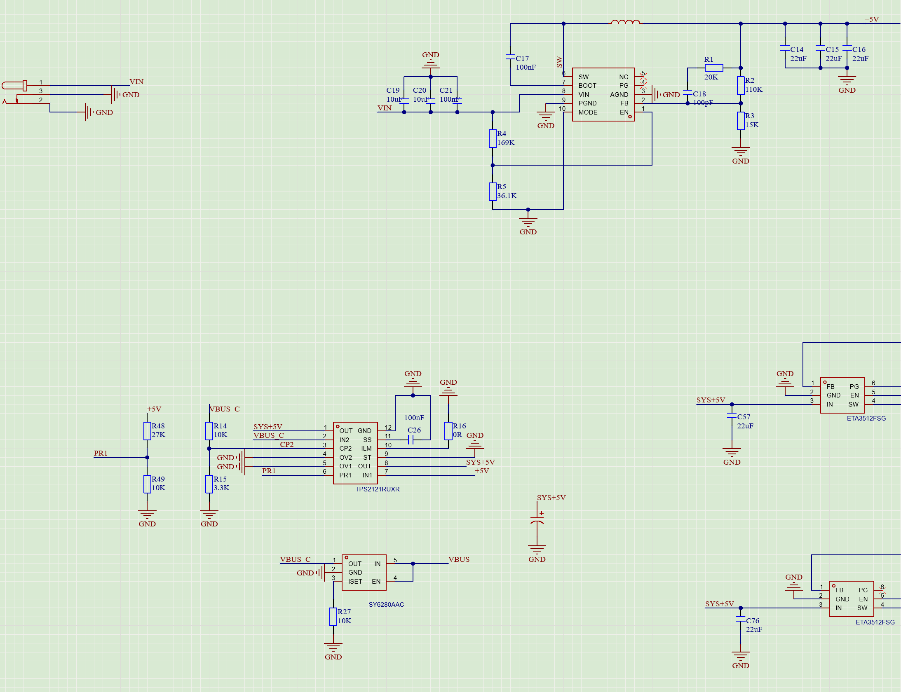

# 硬件踩坑记录

[返回 VL822 拓展坞项目](README.md)

## 01｜PG 接 EN 控制上电时序，漏加上拉导致 1.05 V 无输出

**供电与级联：** VL822 使用两颗 ETA3512FSG，分别输出 **3.3 V** 和 **1.05 V**。为保证 3.3 V 先于 1.05 V 上电，将 **3.3 V 电源的 PG 接到 1.05 V 电源的 EN**，由前级电源就绪信号使能后级。

**现象：** 调试时 3.3 V 正常，1.05 V 没有输出。

**原因：** 前级 PG 为开漏输出，漏加上拉电阻后，即使 3.3 V 已正常输出，PG / EN 节点也无法被上拉为高电平，后级 1.05 V 电源未被使能。

**处理：** 在 PG 与 EN 的连接节点飞线，通过 **100 kΩ 电阻上拉到 3.3 V**，1.05 V 恢复输出。

## 02｜USB-A 连接器选型未考虑 10 Gbps，信号完整性裕量不足

**问题：** USB-A 在 5 Gbps 下传输稳定，但到 10 Gbps 时已接近信号完整性边界，缺少裕量。

**原因：** 连接器选型时只考虑了 USB 3.0 接口，未考虑对 10 Gbps 传输的适配。

**改进：** 更换为明确支持 10 Gbps 的 USB-A 连接器。

## 03｜TPS2121 切换阈值过低，切换供电时 USB 掉识别

**供电结构：** 电脑 USB 电源 VBUS_C 接 TPS2121 的 IN2，外接 12 V 降压后的 +5 V 接 IN1，OUT 输出 SYS+5V。

**现象：** 从电脑 USB 供电切换到外接 12 V 供电时，USB 设备掉识别。

**切换设置：** 原图中 R48、R49 将外接降压输出分压到 PR1，R14、R15 将 USB 电源分压到 CP2。

| 分压节点 | 上臂电阻 | 下臂电阻 |
| --- | --- | --- |
| PR1 | R48：27 kΩ | R49：10 kΩ |
| CP2 | R14：10 kΩ | R15：3.3 kΩ |

按 TI 手册第 9.5、10.3 节，当 PR1、CP2 均高于内部参考电压（典型值 1.06 V）时，芯片比较两者电压：PR1 > CP2 选择 IN1，否则选择 IN2。

按图中原阻值、VBUS_C = 5.0 V 计算：

```text
VCP2 = 5.0 × 3.3 / (10 + 3.3) ≈ 1.241 V
VPR1 = VIN1 × 10 / (27 + 10)
切换点：VIN1 ≈ 1.241 × 37 / 10 ≈ 4.59 V
```

**原因：** 原切换点偏低，外接降压输出上升到约 4.59 V 就达到切换条件，调试中切换供电会导致 USB 掉识别。

**处理：** 将 **R48 从 27 kΩ 改为 30 kΩ**，从电脑 USB 供电切换到外接 12 V 供电不再掉识别。

按 VBUS_C = 5.0 V、其余电阻采用图示阻值计算：

| R48 | 外接降压输出的切换点 |
| --- | --- |
| 修改前：27 kΩ | 约 4.59 V |
| 修改后：30 kΩ | 约 4.96 V |

```text
修改后切换点 = 5.0 × 3.3 / (10 + 3.3) × (30 + 10) / 10
             ≈ 4.96 V
```



参考：[TI TPS2121 数据手册，第 9.5 节和第 10.3 节](https://www.ti.com/lit/ds/symlink/tps2121.pdf)。
