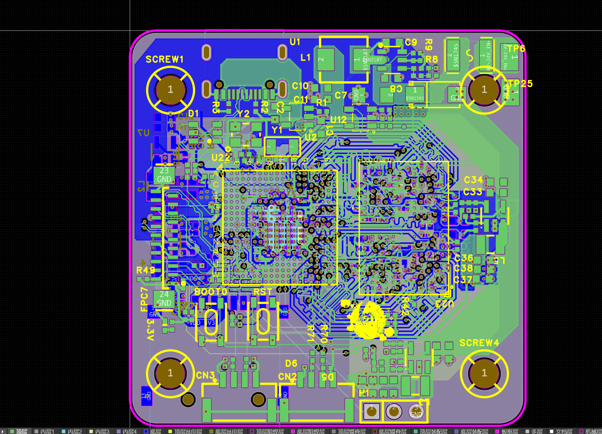
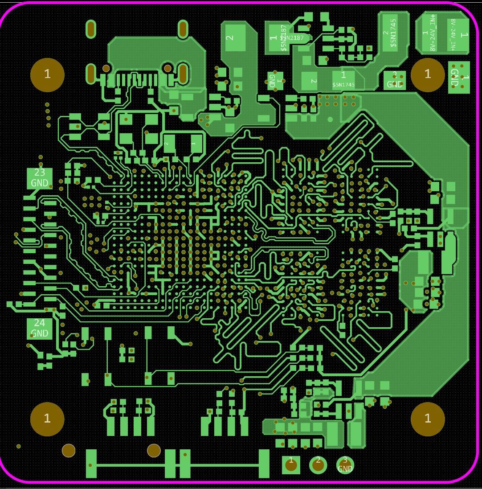
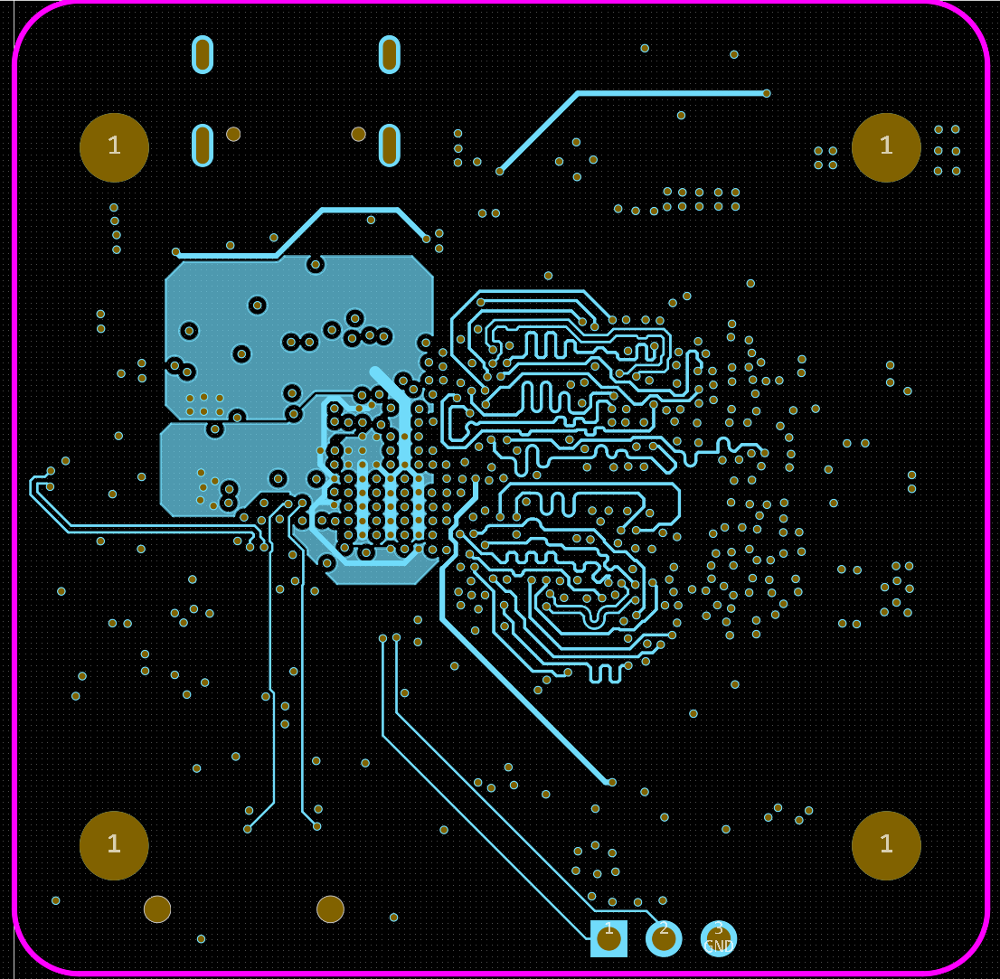
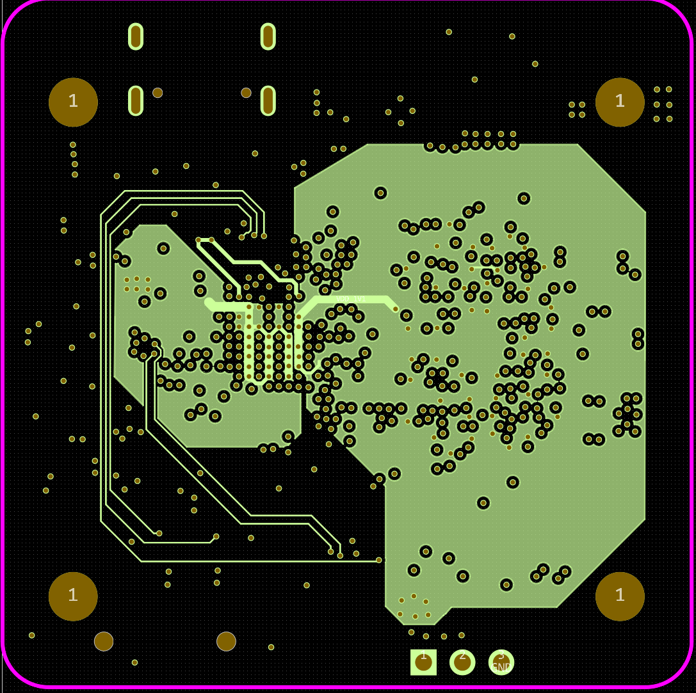
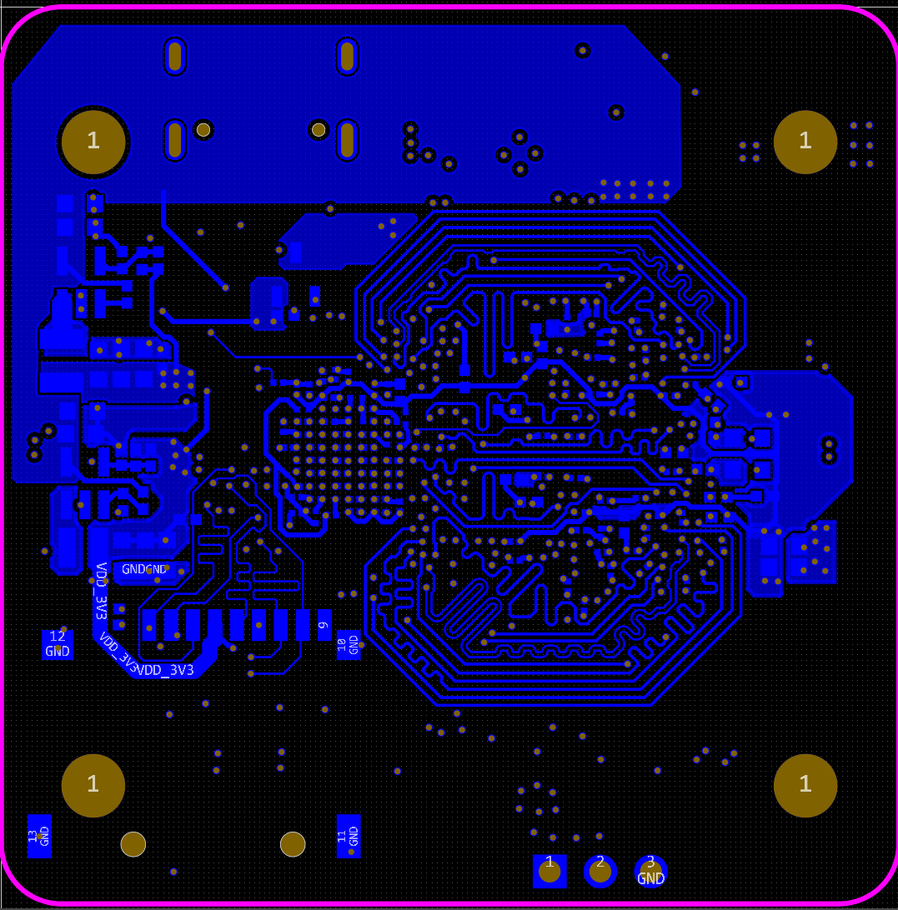

# K230 + LPDDR4 六层紧凑核心板

基于 K230 与 LPDDR4 的紧凑核心板，尺寸 **45 × 45 mm**，采用六层 PCB 和嘉立创免费工艺，面向飞控应用。

## 项目概览

| 项目 | 内容 |
| --- | --- |
| 主控 | K230 |
| 内存 | LPDDR4 |
| PCB | 六层板 |
| 板尺寸 | 45 × 45 mm |
| 制板工艺 | 嘉立创免费工艺 |
| 应用方向 | 飞控 |

[PCB 布局与布线](#pcb-布局与布线) · [工程下载](#工程下载) · [返回项目列表](../../README.md)

## 工程下载

[下载嘉立创 EDA 专业版工程（.epro）](hardware/ProPrj_K230_2026-10-28.epro?raw=true)

## PCB 布局与布线

在 45 × 45 mm 板内完成 K230、LPDDR4 和外围电路的布局布线。以下视图展示 BGA 扇出、内存信号走线和电源铜皮分布。

