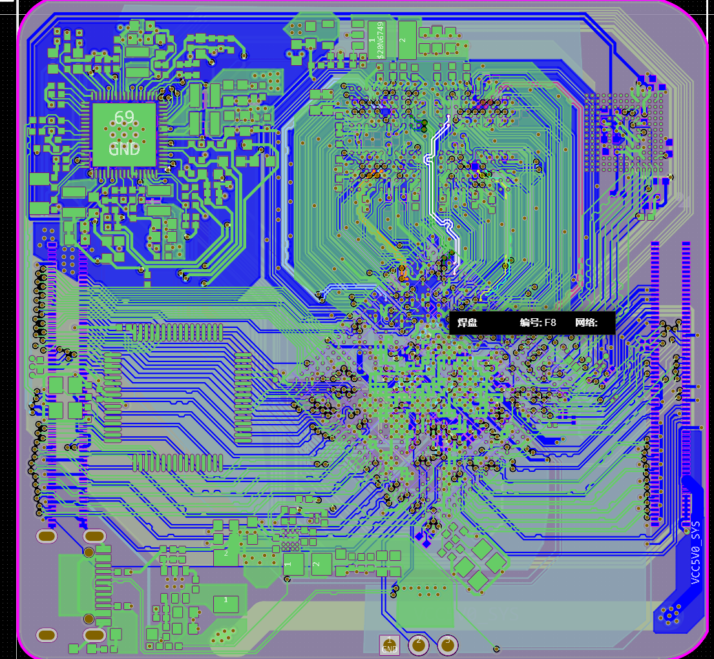
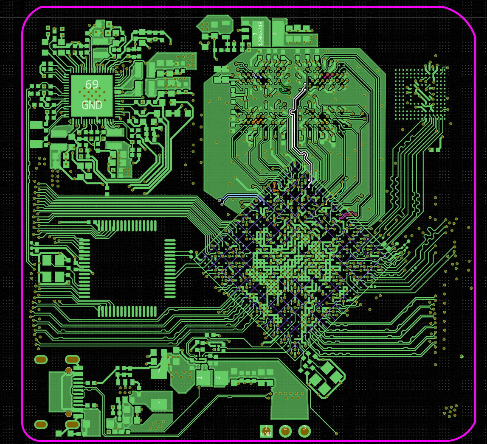
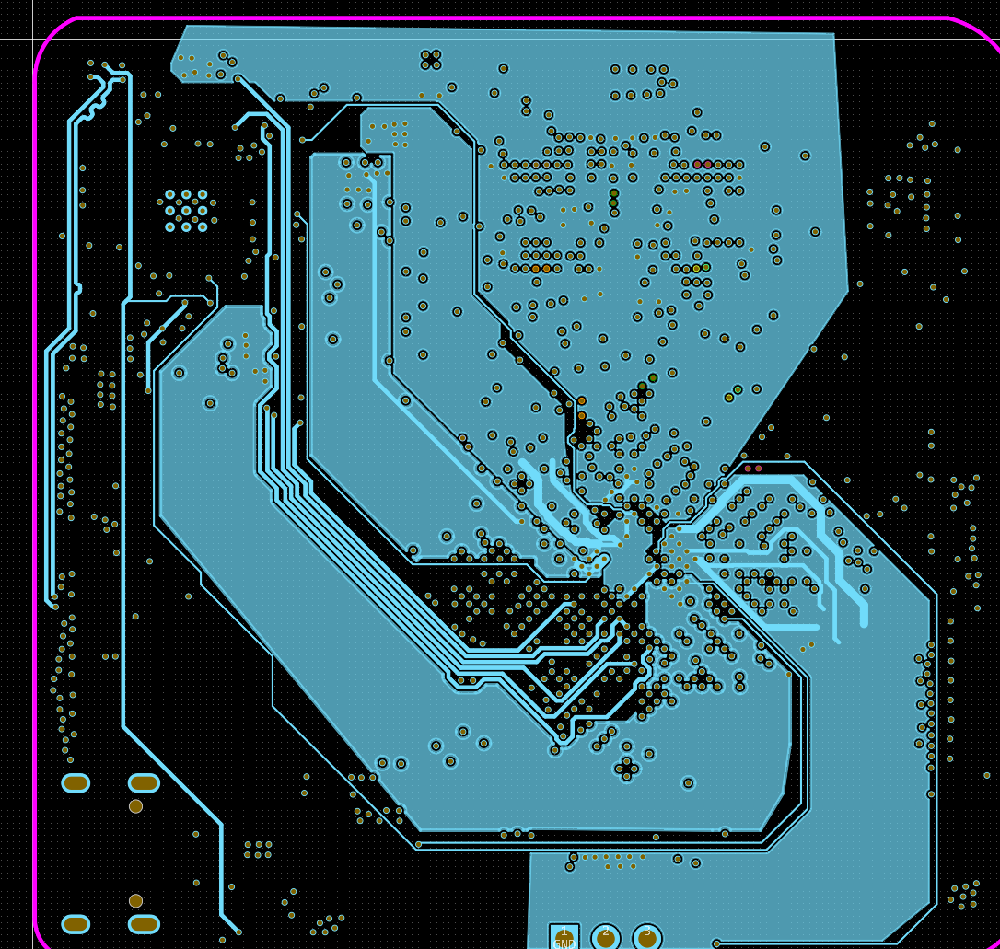
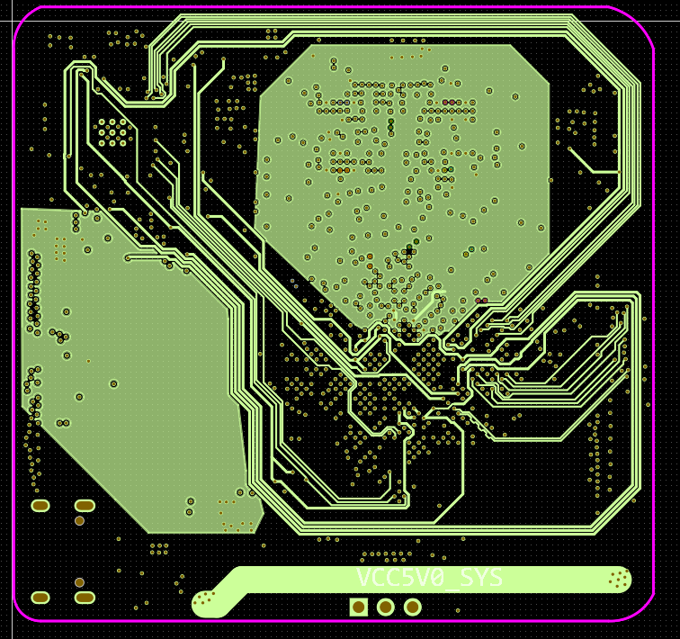
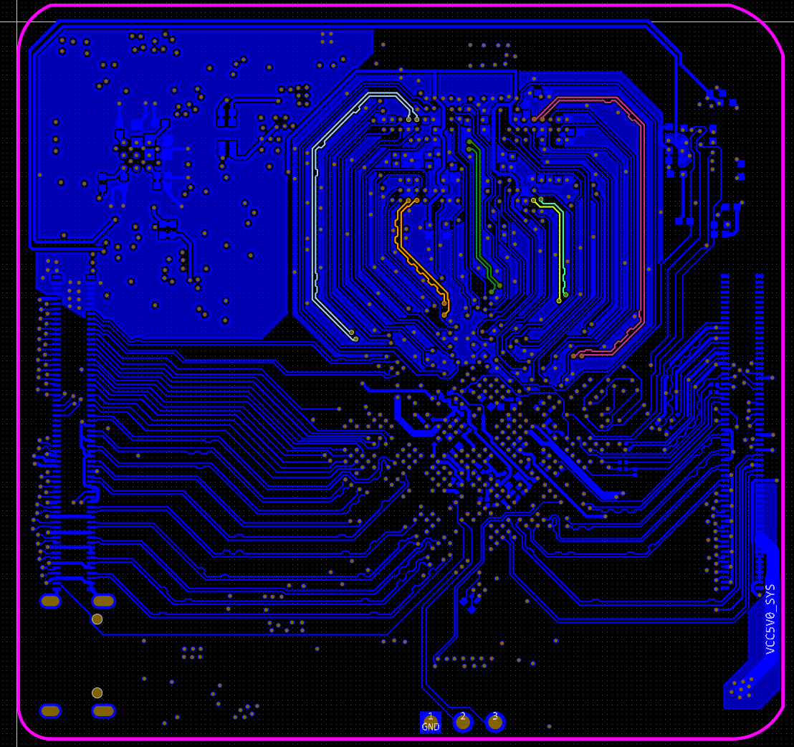

# RK3568 + LPDDR4X + MCU 六层 ROS 机器人控制板

基于 RK3568、LPDDR4X 与 MCU 的六层控制板，面向 ROS 机器人控制。当前已完成 Layout 和打板，尚未焊接及上电验证。

## 项目概览

| 项目 | 内容 |
| --- | --- |
| 处理器 | RK3568 + MCU |
| 内存 | LPDDR4X |
| 应用方向 | ROS 机器人控制 |
| PCB | 六层板 |
| 当前进度 | 已打板，尚未焊接验证 |

[PCB 布局与布线](#pcb-布局与布线) · [工程下载](#工程下载) · [返回项目列表](../../README.md)

## 工程下载

[下载嘉立创 EDA 专业版工程（.epro）](hardware/ProPrj_rk3568B2_2026-10-28.epro?raw=true)

## PCB 布局与布线

布局围绕 RK3568、LPDDR4X、MCU 和外围接口展开。下方视图展示 BGA 扇出、成组信号走线和铜皮分布。

