# RK3588 六层核心板

基于 Rockchip RK3588 的自制核心板，完成电路设计、六层 PCB 布局布线、手工焊接及系统启动调试。在同一块样机上实现 Android 12 图形系统运行、内存测试与 CPU / NPU 本地大模型推理，将硬件设计落实到可运行的应用平台。

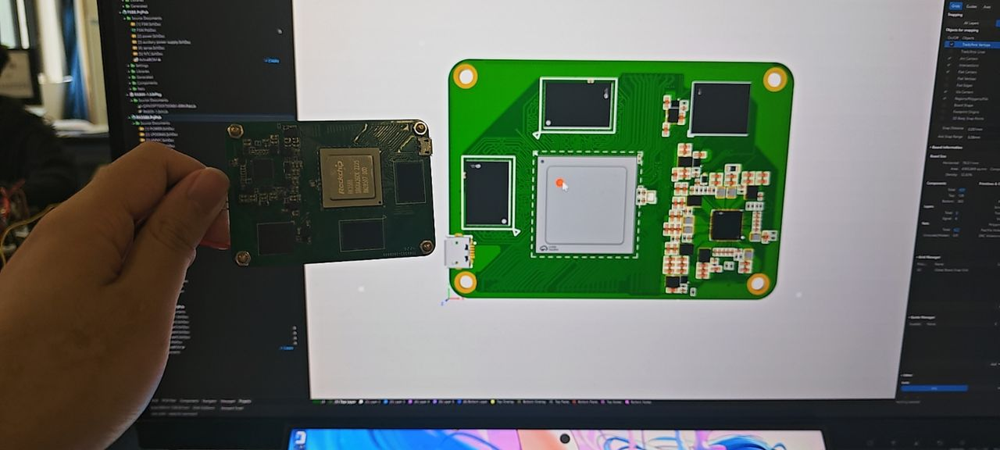

## 项目概览

| 项目 | 内容 |
| --- | --- |
| 主处理器 | Rockchip RK3588 |
| 内存 | 4 GB LPDDR4X，四通道，初始化频点 2112 MHz |
| 存储 | eMMC，日志识别用户区 14910 MB，8-bit 总线、200 MHz 时钟 |
| PCB | 六层板，0.3/0.4 mm 免费过孔规格 |
| 层叠结构 | T — GND — PWR — PWR — GND — B |
| 系统应用 | Android 12 图形界面、3D 游戏、本地大模型对话 |
| 调试与连接 | 串口、USB OTG、ADB、scrcpy 投屏与音频转发、USB 网络共享 |

[应用成果](#应用成果) · [板级验证](#板级验证) · [PCB 设计](#pcb-设计) · [硬件踩坑记录](hardware-notes.md)

## 应用成果

### NPU 本地大模型推理

使用 RKLLM 在 RK3588 上部署 **Qwen3.5-2B W8A8** 模型，完成中文交互与连续对话。运行截图中启用了 3 个 NPU 核心，并记录了模型加载、文本预填充和生成阶段的数据。

一次中文回答生成 162 个 token，生成速度为 **7.88 token/s**，预填充速度为 **42.04 token/s**，峰值内存占用约 **2257 MB**。这项应用把核心板的内存、电源与 NPU 运行环境串联到实际推理任务中。

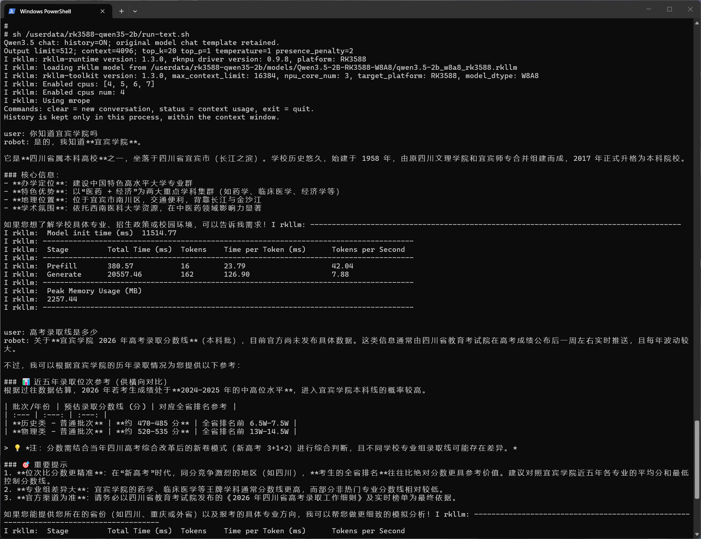

### CPU 本地大模型推理

通过 **llama.cpp** 加载 **Qwen3.5-4B Q4_K_M GGUF** 模型，在板端完成多轮文本交互。截图中的生成速度约为 **5.3–7.2 token/s**，展示了同一硬件平台上的 CPU 推理方案与命令行应用部署能力。

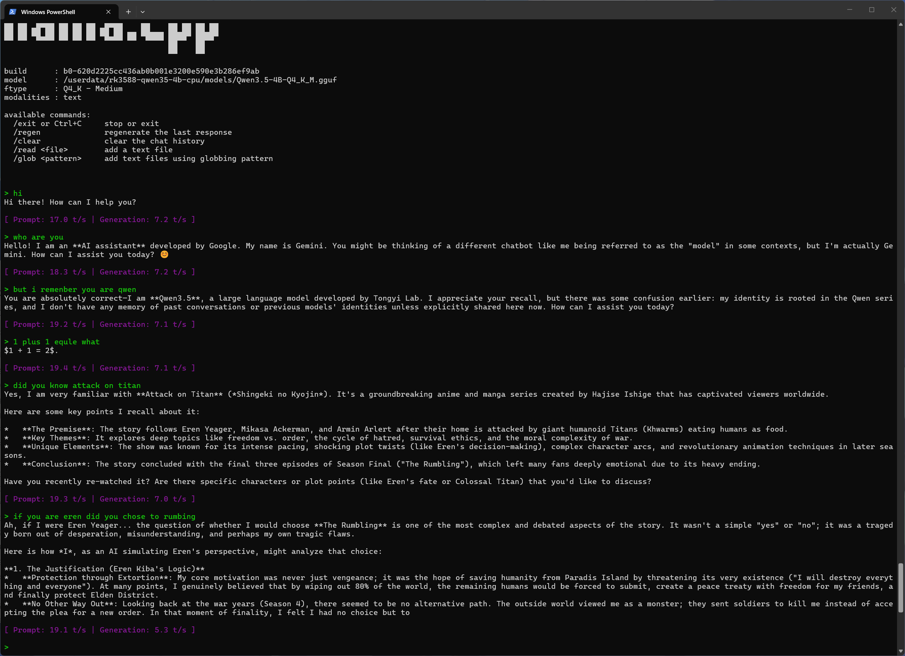

### Android 图形系统与 3D 应用

核心板成功启动 Android 12，通过 USB OTG 接入电脑，使用 ADB 安装应用、scrcpy 显示并操作安卓界面。《我的世界》试玩版已进入实际游戏场景，展示了样机运行图形系统与 3D 应用的成果。

同一 OTG 接口还实现了音频转发和电脑网络共享，形成便于开发与演示的桌面调试环境。

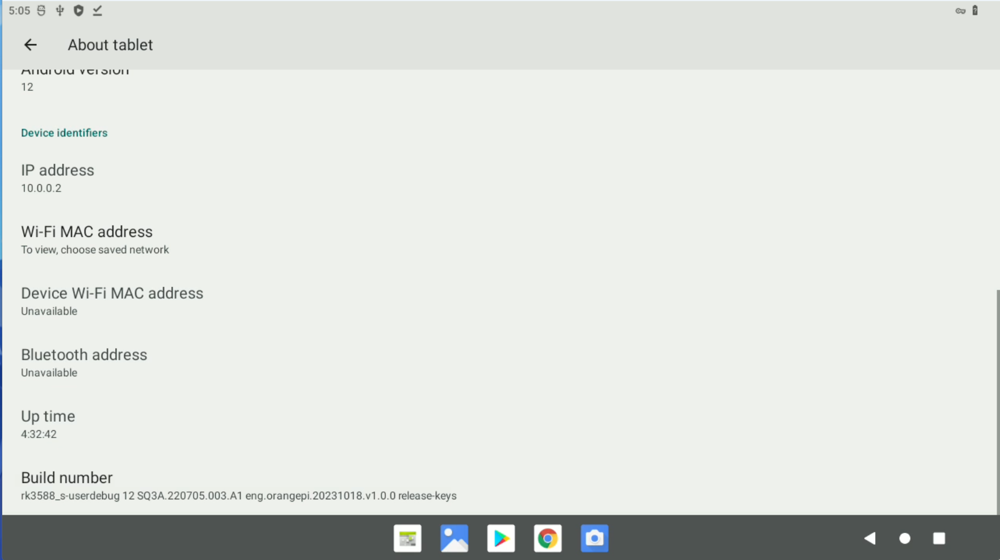

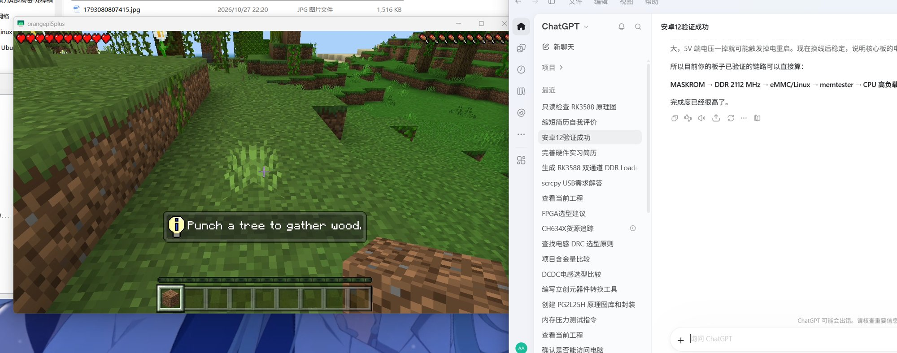

## 板级验证

### DDR 训练与 eMMC 初始化

串口启动日志记录了 DDR 在 **1068 MHz、1560 MHz、2112 MHz** 频点的切换与四通道训练参数，并最终切换到 **F0：2112 MHz**。随后进入 Boot1，完成 eMMC 接口初始化，识别到 **14910 MB** 用户区，配置 **8-bit 总线**和 **200 MHz 时钟**。

| 验证内容 | 日志记录 |
| --- | --- |
| DDR 通道 | CH0–CH3 均输出训练参数 |
| DDR 最后切换频点 | F0：2112 MHz |
| eMMC 数据总线 | 8-bit |
| eMMC 时钟 | 200 MHz |
| eMMC 用户区 | 14910 MB |

[查看启动日志文本](logs/ddr-emmc-boot.txt)

<details>
<summary>展开查看 DDR 与 eMMC 启动日志</summary>

```text
ch0 ttot10
ch1 ttot10
ch2 ttot10
ch3 ttot10
CH0 rx vref:28.5%
CH1 rx vref:29.4%
CH2 rx vref:26.6%
CH3 rx vref:28.5%
change to F2: 1068MHz
ch0 ttot12
ch1 ttot12
ch2 ttot12
ch3 ttot12
CH0 rx vref:28.5%
CH1 rx vref:29.4%
CH2 rx vref:26.6%
CH3 rx vref:28.5%
change to F3: 1560MHz
ch0 ttot14
ch1 ttot14
ch2 ttot14
ch3 ttot14
CH0 rx vref:28.5%
CH1 rx vref:29.4%
CH2 rx vref:26.6%
CH3 rx vref:28.5%
change to F0: 2112MHz
ch0 ttot16
ch1 ttot16
ch2 ttot18
ch3 ttot16
stride=0x2, ddr_config=0x0
hash ch_mask0-1 0x20 0x40, bank_mask0-3 0xa00 0x1400 0x2800 0x0, rank_mask0 0x0
out
Boot1 Release Time: Oct 17 2023 17:09:54, version: 1.11
Emmc IO init.
Emmc IO init.
mmc_set_bus_width: 1
SetEmmcClk: 375000, 2, 64
mmc_switch index:183, value:0x2
mmc_switch index:185, value:0x2
SetEmmcClk: 375000, 2, 64
mmc_set_bus_width: 8
SetEmmcClk: 200000000, 0, 3
Enable PHY CLK: 200000000, timing: 9
SdmmcInit=2 0
BootCapSize=100000
UserCapSize=14910MB
FwPartOffset=2000 , 100000
UsbBoot ...150344
powerOn 152622
```

</details>

### 内存读写测试

LPDDR4X 四通道完成初始化，启动日志报告总容量 **4 GB**，初始化频点 **2112 MHz**。在系统启动后进一步使用 memtester 检查内存读写，包括随机数据、算术比较、位模式和顺序写入等测试项。

| 测试 | 截图结果 |
| --- | --- |
| 2048 MB 内存测试，1 轮 | PASS，0 failures |
| 1024 MB 内存测试，10 轮 | PASS，0 failures |

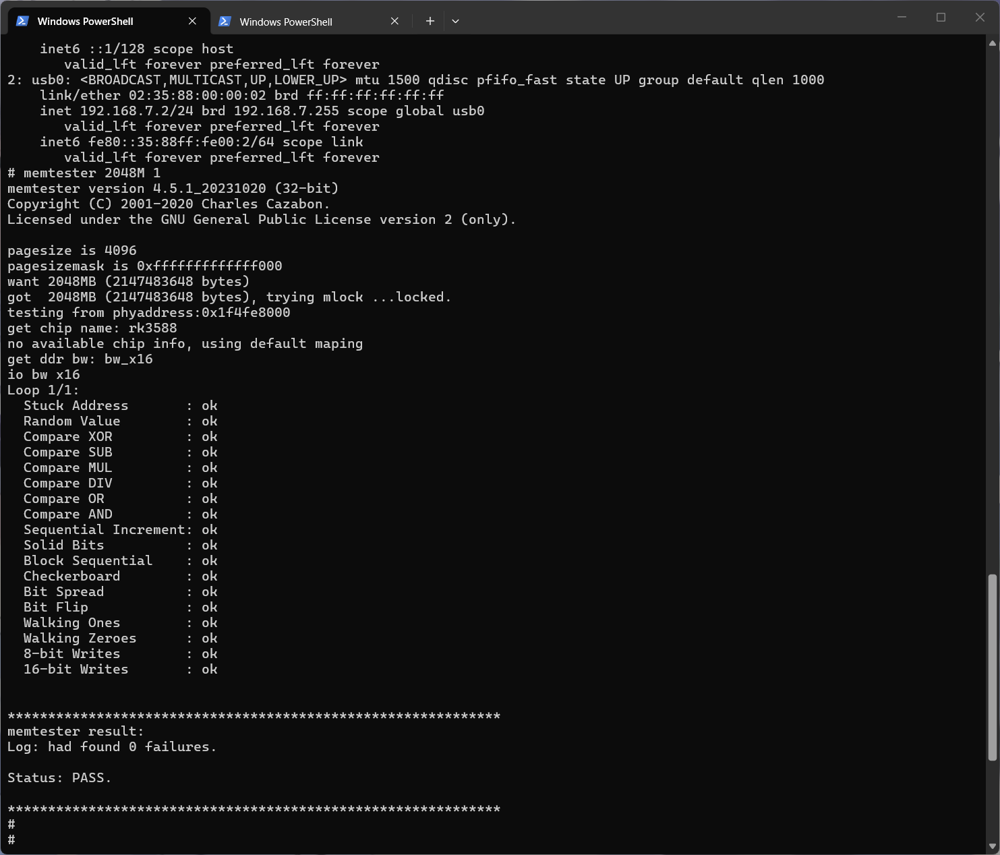

<details>
<summary>展开查看 1024 MB × 10 轮测试结果</summary>

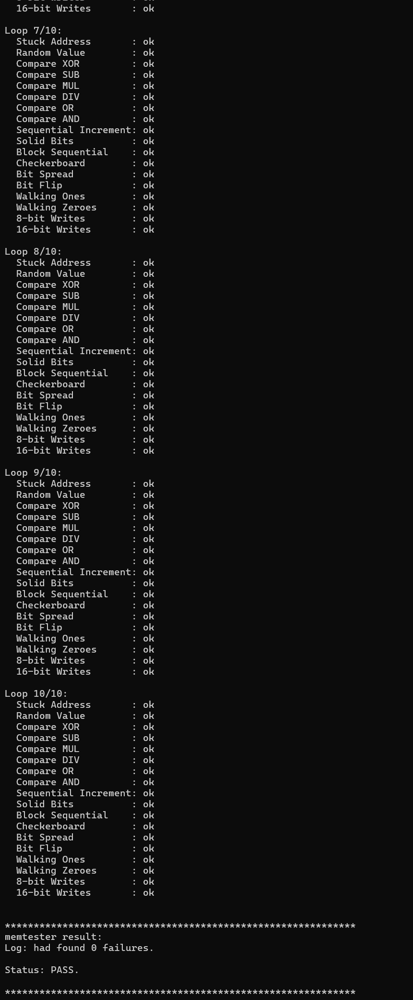

</details>

## PCB 设计

参考 Rockchip 官方硬件方案，完成处理器、LPDDR4X、电源和接口电路的设计与板级实现。采用六层 PCB，在 **T — GND — PWR — PWR — GND — B** 叠构下完成 BGA 扇出、DDR 等长、供电分配及接口布线，并使用 **0.3/0.4 mm 免费过孔规格**实现样机制作。

### 层叠与阻抗

使用华秋 **06161HA3-1080** 层叠结构进行阻抗计算，覆盖 **50 Ω、40 Ω 单端**及 **80 Ω 差分**参数。下图给出对应的线宽、线距、参考层和介质厚度。

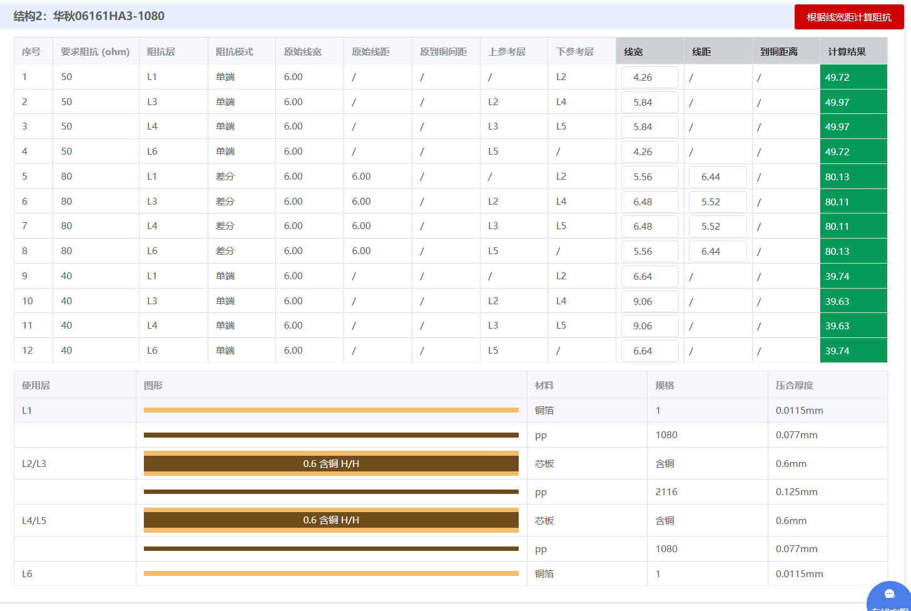

### 四层布线

以下四张图对应六层板中的四个布线层，展示 DDR 等长、处理器扇出、电源铜皮与接口走线的布置。

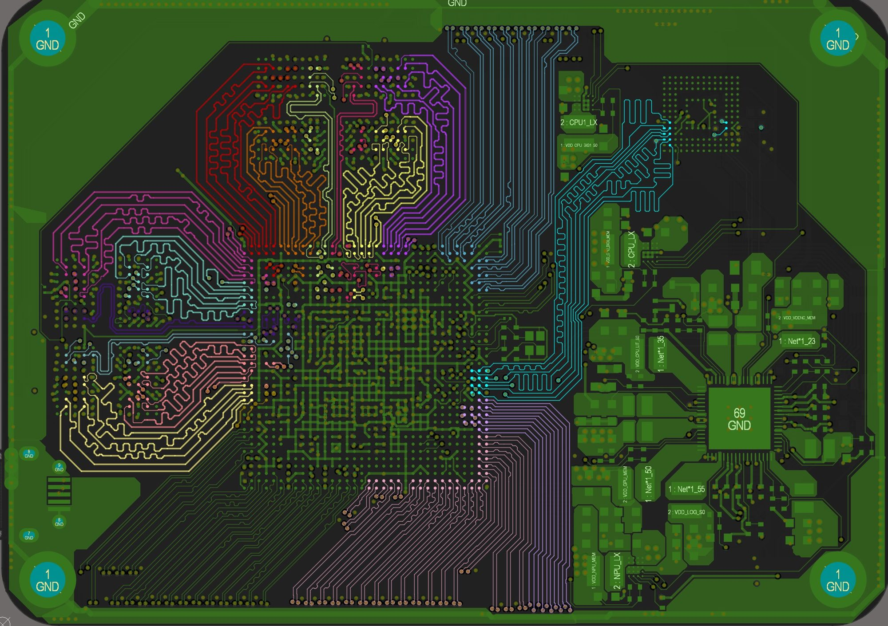

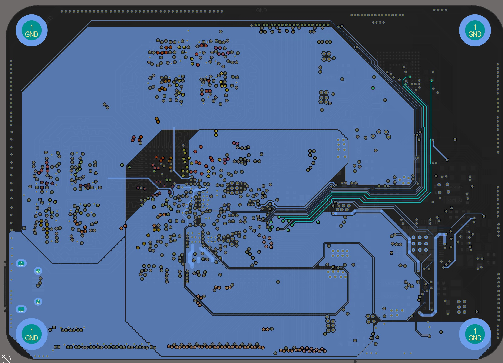

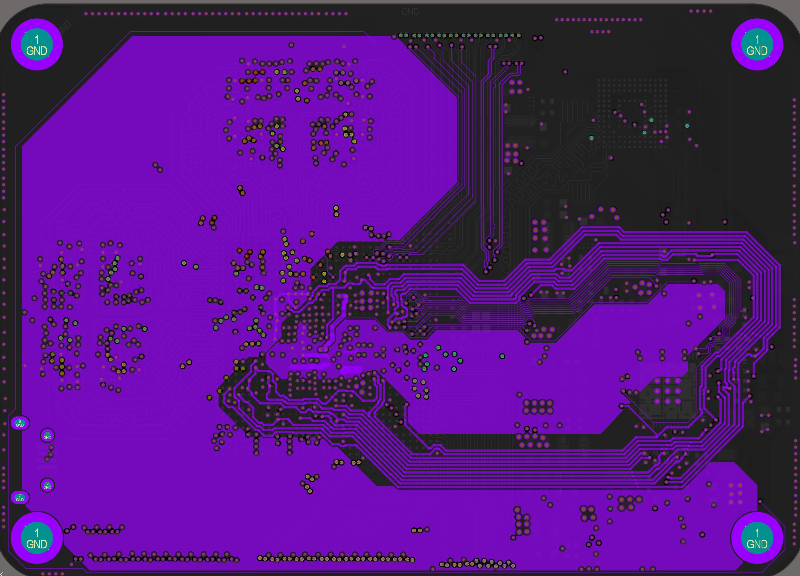

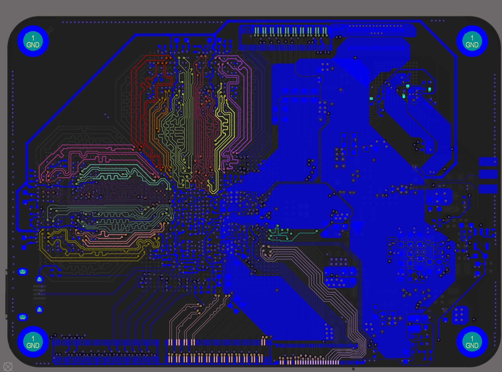

<details>
<summary>展开查看 DDR 部分布线</summary>

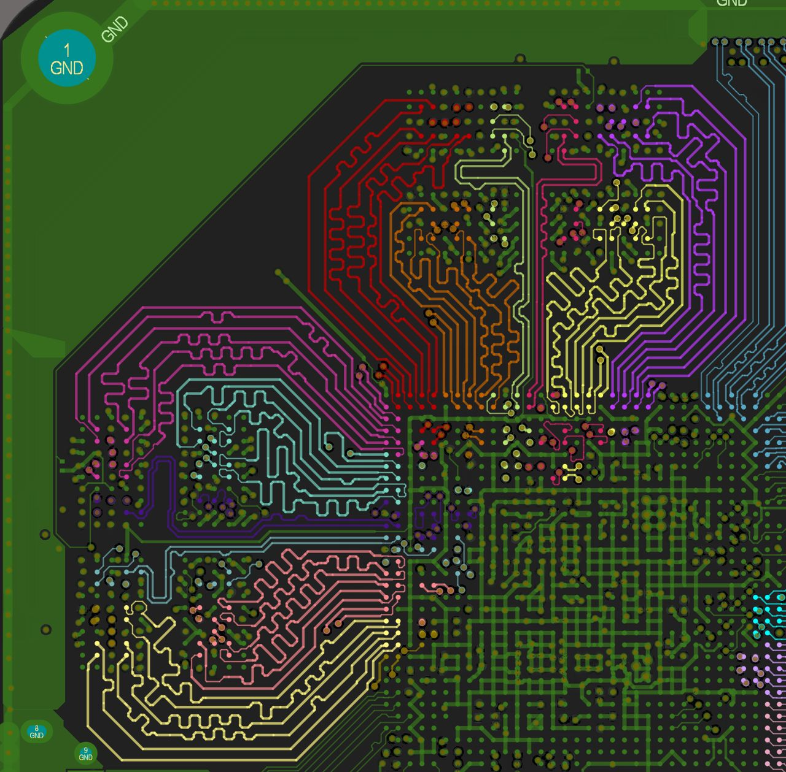

</details>
