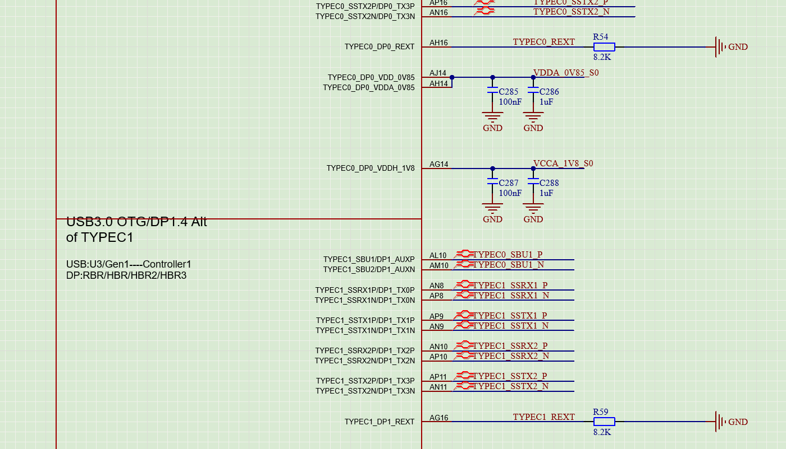
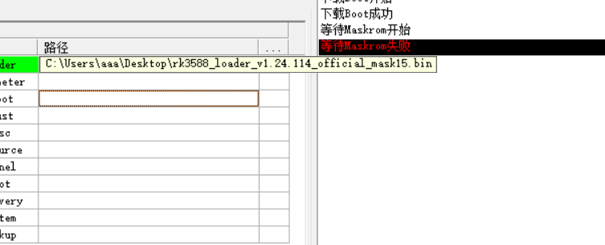

# 硬件踩坑记录

[返回 RK3588 项目](README.md)

## 01｜TYPEC PHY 的两颗 8.2 kΩ REXT 电阻不能漏焊

### 现象与定位

样机最初只焊接了 OTG0_REXT 的 200 Ω 电阻，TYPEC0_REXT 和 TYPEC1_REXT 的两颗 8.2 kΩ 电阻均未焊接。此时 USB OTG 下载口没有正常枚举，RKDevTool 无法识别 MASKROM 设备。

排查时，BOOT、复位、24 MHz 时钟及 USB PHY 电源已逐项确认。继续检查 TYPEC PHY 电路后发现两颗 REXT 电阻漏焊，补焊后恢复 USB 枚举，RKDevTool 成功识别 MASKROM。

### 对应位置

| 位号 | 网络 | 阻值 | 连接 |
| --- | --- | --- | --- |
| R54 | TYPEC0_REXT | 8.2 kΩ | REXT 至 GND |
| R59 | TYPEC1_REXT | 8.2 kΩ | REXT 至 GND |



### 实测结果

| 项目 | 本板实测 |
| --- | --- |
| 输入电压 | 5 V |
| MASKROM 状态输入电流 | 约 130 mA |
| 电脑端识别结果 | RKDevTool 显示“发现一个 MASKROM 设备” |

**装配要点：本板即使用 Micro-USB OTG0 下载，TYPEC0_REXT、TYPEC1_REXT 的两颗 8.2 kΩ 电阻也必须焊接。** 调试时结合约 130 mA 的实测电流观察上电状态，以 RKDevTool 的 MASKROM 枚举结果确认下载通道。

## 02｜DDR、eMMC 初始化完成，但“等待 MASKROM”失败

### 故障现象

USB Device Tree Viewer 与 RKDevTool 同时运行时，串口已经输出 DDR 训练、eMMC 识别及初始化末尾日志，但 RKDevTool 卡在以下阶段：

```text
下载Boot成功
等待Maskrom开始
等待Maskrom失败
```



### 日志定位

当天 RKDevTool 的同类故障记录：

```text
21:07:07 981  Layer<3-1>:下载Boot开始
21:07:11 870  Layer<3-1>:下载Boot成功
21:07:11 871  Layer<3-1>:等待Maskrom开始
21:07:17 021  Error:Layer<3-1>:等待Maskrom失败
```

等待期间，工具自身的 USB 扫描日志反复出现：

```text
21:07:12 227  Error:EnumerateHubPorts-->DeviceIoControl get serial string failed,index=1,err=0x1f
```

定位结果是：**Boot 数据已发送，板端初始化已经运行，失败发生在后续 USB 设备响应与重新识别阶段。** 工具在约 5 秒的等待窗口内没有完成下一阶段的设备识别。

### 原因分析

USB Device Tree Viewer 会主动读取 USB 描述符，部分失败查询还会在后台重试。描述符读取也会经过设备的 USB 控制端点，因此它打开时会增加对设备的查询。

结合本次关闭 Tree Viewer 后恢复的调试结果，优先排查 **USB 描述符查询与下载程序切换、重新识别之间的兼容性干扰**。现有日志已经定位到 USB 响应和主机扫描阶段；具体触发请求及驱动、设备端的处理顺序，需要 USB 抓包确认。扫描日志中的错误来自 RKDevTool 自身，也不能直接等同于 Tree Viewer 独占了设备。

### 处理方式

查看拓扑后先退出 USB Device Tree Viewer，再使用 RKDevTool。若已经出现“等待 MASKROM 失败”，给板子重新上电，重新连接 OTG，再执行下载。

**调试要点：本板下载固件时，USB Device Tree Viewer 与 RKDevTool 分开运行；同时观察串口初始化日志和工具的 USB 识别结果。**

### 参考资料

- [USB Device Tree Viewer 作者说明](https://www.uwe-sieber.de/usbtreeview_e.html)：描述符读取及失败请求后台重试。
- [Microsoft：USB 描述符查询接口](https://learn.microsoft.com/en-us/windows-hardware/drivers/ddi/usbioctl/ni-usbioctl-ioctl_usb_get_descriptor_from_node_connection)：通过 USB Hub 查询设备描述符。
- [Rockchip rkdeveloptool：DownloadBoot 实现](https://github.com/rockchip-linux/rkdeveloptool/blob/master/RKDevice.cpp#L493-L565)：分阶段发送 Boot 数据并报告传输结果。
