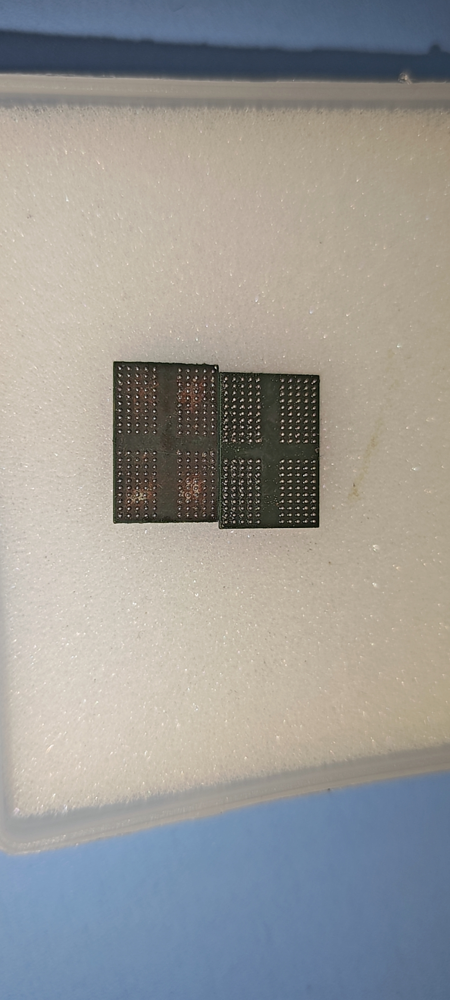

# 硬件踩坑记录

[返回 RK3588 项目](README.md)

## 01｜TYPEC PHY 的两颗 8.2 kΩ REXT 电阻不能漏焊

### 现象与定位

样机最初只焊接了 OTG0_REXT 的 200 Ω 电阻，TYPEC0_REXT 和 TYPEC1_REXT 的两颗 8.2 kΩ 电阻均未焊接。此时 USB OTG 下载口没有正常枚举，RKDevTool 无法识别 MASKROM 设备。

排查时，BOOT、复位、24 MHz 时钟及 USB PHY 电源已逐项确认。继续检查 TYPEC PHY 电路后发现两颗 REXT 电阻漏焊，补焊后恢复 USB 枚举，RKDevTool 成功识别 MASKROM。

### 对应位置

| 位号 | 网络 | 阻值 | 连接 |
| --- | --- | --- | --- |
| R54 | TYPEC0_REXT | 8.2 kΩ | REXT 至 GND |
| R59 | TYPEC1_REXT | 8.2 kΩ | REXT 至 GND |

### 实测结果

| 项目 | 本板实测 |
| --- | --- |
| 输入电压 | 5 V |
| MASKROM 状态输入电流 | 约 130 mA |
| 电脑端识别结果 | RKDevTool 显示“发现一个 MASKROM 设备” |

**装配要点：本板即使用 Micro-USB OTG0 下载，TYPEC0_REXT、TYPEC1_REXT 的两颗 8.2 kΩ 电阻也必须焊接。** 调试时结合约 130 mA 的实测电流观察上电状态，以 RKDevTool 的 MASKROM 枚举结果确认下载通道。

## 02｜USB Tree Viewer 干扰下载识别

**现象：** USB Tree Viewer 与 RKDevTool 同时打开时，串口已完成 DDR、eMMC 初始化，但工具提示“下载 Boot 成功，等待 MASKROM 失败”。

**原因分析：** 日志显示 USB 描述符读取失败，怀疑 Tree Viewer 的主动查询干扰了下载后的 USB 重新识别。具体冲突需抓包确认。

**处理：** 退出 USB Tree Viewer，重新给板子上电，再用 RKDevTool 下载。

[Tree Viewer 查询机制说明](https://www.uwe-sieber.de/usbtreeview_e.html)

## 03｜0201 电容在运行中短路

**现象：** 运行 YOLO Demo 时板子突然掉线，再次上电出现大电流，检查发现 **LOG 电源域对地短路**。

**定位：** 拆除该电源域的一颗 0201 电容后，对地阻值恢复，故障定位到这颗电容。

**疑似原因：** 焊接后未充分冷却就用洗板水刷洗，可能因温度骤变造成陶瓷电容内部微裂纹，后续运行时发展为短路。

**经验：** 焊接后先让板子自然冷却，再进行清洗，避免高温状态下直接接触洗板水。

## 04｜DDR 反复植球导致基板露出、连锡

**现象：** DDR 植球后出现连锡，上板后 DDR 训练失败。下图左侧 DDR 因反复植球，局部基板露出；继续植球时受损位置会连锡，影响 DDR 正常训练。

**经验：** 避免对同一颗 DDR 反复植球；植球前检查基板和焊盘状态，发现基板露出等损伤时不要继续使用该芯片。热风植球时将风速调低，风嘴垂直吹向芯片，不要斜吹，以免将锡球吹歪。
