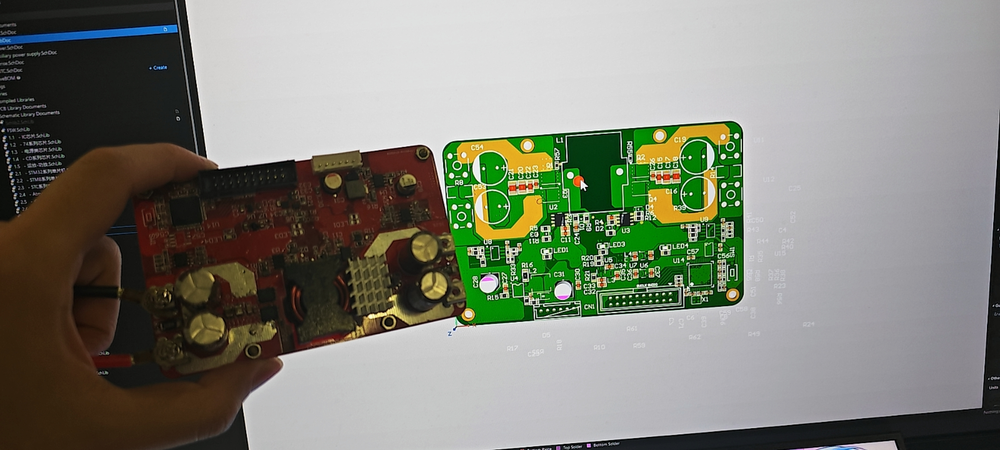
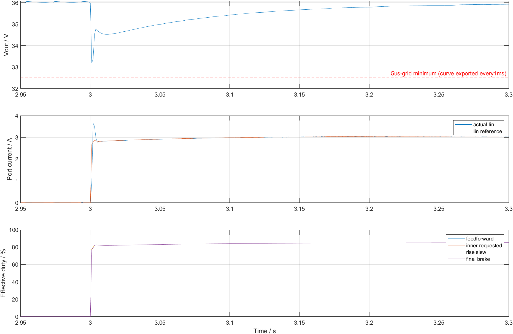
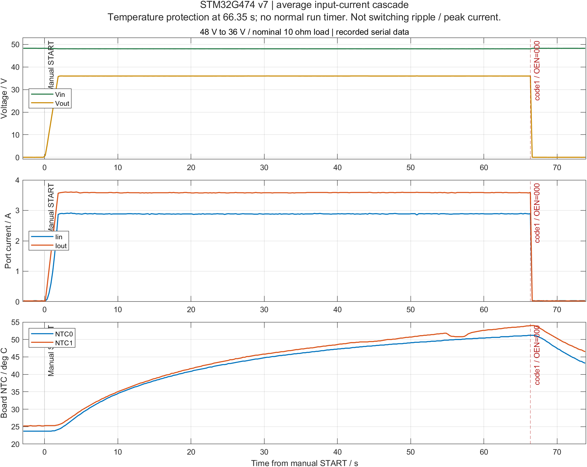
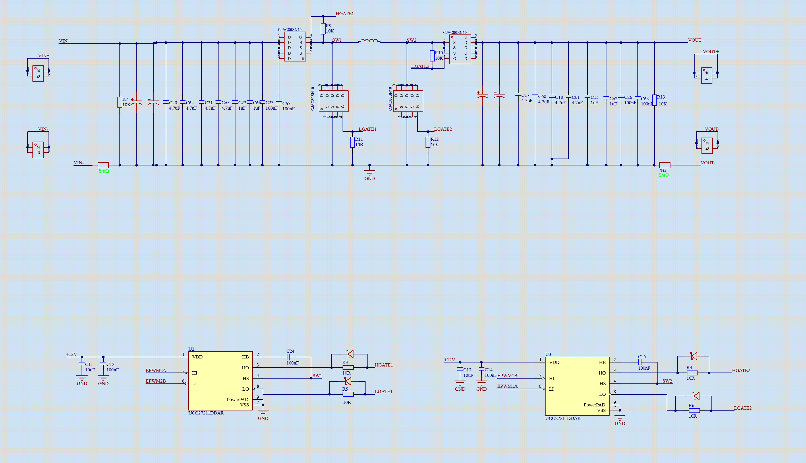
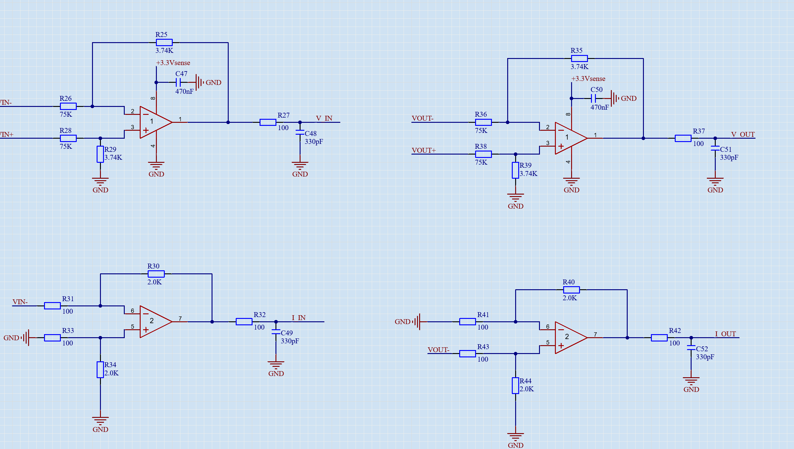

# STM32G474 四开关 Buck-Boost 数字电源

基于 STM32G474 的四开关数字电源，使用 HRTIM 生成 200 kHz PWM，采用电压外环和平均输入电流内环控制。配套 Windows 串口上位机，用于查看电压、电流、温度和运行状态。

目前完成 Buck 模式的 **48 V → 36 V、10 Ω 负载、约 130 W** 测试，效率 **93.2%**，运行 **66.35 秒**后触发温度保护。Boost 和模式自动切换尚未完成。



## 项目概览

| 项目 | 配置 |
| --- | --- |
| 主控 | STM32G474RBTx，170 MHz |
| 拓扑 | 非隔离四开关 Buck-Boost |
| 当前工作模式 | Buck，输入桥互补 PWM，输出桥关闭，经 Q3 体二极管传能 |
| PWM | HRTIM，200 kHz |
| 死区 | 120.588 ns |
| 带载工况 | 输入 48 V，输出 36 V，10 Ω 负载 |
| 带载效率 | 93.2% |
| 功率级参数 | 电感 15 µH，输出电容名义约 901 µF |
| 控制更新频率 | 电压外环 10 kHz，平均输入电流内环 50 kHz |
| 上位机 | C# / Windows Forms，串口 115200 |
| 固件 | CLEANBUCK36-CASCADE-20261027-v7 |

[控制设计](#控制设计) · [板级验证](#板级验证) · [算法仿真](#算法仿真) · [硬件设计](#硬件设计) · [源码与固件](#源码与固件) · [硬件踩坑记录](hardware-notes.md)

## 控制设计

### 双环控制

电压外环根据输出电压误差给出输入电流参考，电流内环根据平均输入端口电流调整 PWM。控制链中加入前馈、滤波、参考斜坡和占空比限幅，轻载采用脉冲分配。

控制器使用同一份 [C 源码](CleanBuck36/Simulation/CurrentCascade/cascade_control.c)，同时用于 MCU 固件和离线仿真。



### PWM 与保护

v7 中 Q1/Q2 由 HRTIM 输出互补 PWM，Q3/Q4 保持关闭。系统上电停波，通过上位机按钮启动；过流、过压、温度异常和控制超时均会停波并锁存故障。

[控制参数、PWM 定义与保护设置](docs/control-and-pwm.md)

## 板级验证

### 48 V → 36 V 带载测试

10 Ω 负载下，输出保持在 36 V 附近，输出电流约 3.6 A。运行 66.35 秒后触发 code1 温度保护，四路门极输出关闭。

| 测试项 | 结果 |
| --- | --- |
| 输入电压 | 约 48 V |
| 输出电压 | 约 36 V |
| 输出电流 | 约 3.6 A |
| 输出功率 | 约 130 W |
| 效率 | 93.2% |
| 运行时间 | 66.35 秒 |
| 故障窗口 NTC 最高值 | NTC0：51.2 °C；NTC1：54.0 °C |
| 停机状态 | code1 温度保护，OEN=000 |



<details>
<summary>串口记录节选</summary>

```text
CASCADE Iref=2864mA Iobs=2861mA active=1
TEST DONE fw=CLEANBUCK36-CASCADE-20261027-v7 fault=1 OEN=000 startUsed=1
```

</details>

[完整测试记录](docs/test-results.md) · [串口日志](tests/v7-serial.jsonl) · [遥测数据](tests/v7-telemetry.csv)

### 早期调试记录

v6 近空载时，目标电压附近的遥测值为 **35.98–36.08 V**。开环 v12 在约 35 V 输入、10 Ω 负载下，输出约 **28.3–28.6 V、80–82 W**。

## 算法仿真

MATLAB 用于线性模型和参数设计，C 仿真使用固件中的控制算法。测试包含启动、负载变化、输入变化、采样误差和故障注入。

| 仿真检查 | 结果 |
| --- | --- |
| 线性模型组合 | 2313 组通过 |
| 非线性测试 | 31 项通过，包括跟踪、限流和保护关断 |
| 内环最小相位 / 增益裕量 | 54.85° / 11.50 dB |
| 外环最小相位 / 增益裕量 | 75.22° / 13.74 dB |

[仿真结果与运行方法](docs/simulation.md) · [场景数据](CleanBuck36/Simulation/Results/input-cascade/nonlinear/summary.csv)

## 硬件设计

### 功率级与驱动

输入桥和输出桥之间串联电感，输入、输出分别设置电流采样。下图为早期功率级与驱动原理图，输入桥驱动在调试中由 UCC27211 更换为 EG27211。



### 电压与电流采样

输入和输出均有电压、电流采样。电压通路采用差分衰减，电流通路采用 **5 mΩ 分流电阻、约 20 倍放大**，信号经 RC 滤波后送入 ADC。



[器件配置与硬件版本记录](hardware/README.md)

## 源码与固件

| 资料 | 入口 |
| --- | --- |
| Altium 原理图与 PCB | [FSW 硬件工程](hardware/fsw-altium-20261028.zip?raw=true) |
| MCU 固件与 Keil 工程 | [FirmwareCascade](CleanBuck36/FirmwareCascade) |
| 串口上位机 | [Monitor](CleanBuck36/FirmwareCascade/Monitor) |
| 已烧录 v7 固件 | [CLEANBUCK36_BENCH.hex](releases/v7/CLEANBUCK36_BENCH.hex) |
| C / MATLAB 仿真 | [Simulation](CleanBuck36/Simulation) |
| 构建与使用 | [使用说明](docs/build-and-run.md) |
| 文件校验 | [SHA256SUMS.txt](SHA256SUMS.txt) |

[下载完整资料包](https://github.com/555AA670/hardware-portfolio/raw/refs/heads/main/projects/stm32g474-four-switch-buck-boost/releases/stm32g474-four-switch-20261028.zip)

硬件工程包含 PCB、5 张原理图及元件库，使用 Altium Designer 打开 FSBB.PrjPcb。

[许可说明](LICENSE-STATUS.md) · [返回项目列表](../../README.md)
