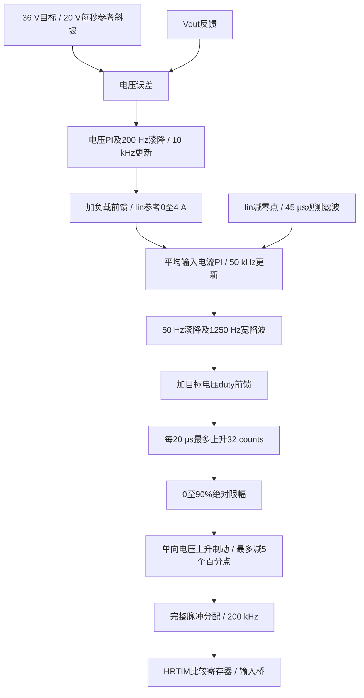

# 控制链与PWM定义

## 同一份C源码

固件工程直接链接[控制器](../CleanBuck36/Simulation/CurrentCascade/cascade_control.c)，仿真使用同一文件。C源码SHA256：

`A7A96114D57B099ED19BFDEB3861E5CD616B7BBE8AF8E3E356A1231ABFAED112`

集成与保护位于[main.c](../CleanBuck36/FirmwareCascade/Core/Src/main.c)，外设配置位于[board.c](../CleanBuck36/FirmwareCascade/Core/Src/board.c)，阈值与身份位于[bench_config.h](../CleanBuck36/FirmwareCascade/Core/Inc/bench_config.h)。

电压PI：Kp=0.1 A/V、Ki=2 A/(V·s)。电流PI：Kp=0.002 duty/A、Ki=75 duty/(A·s)。陷波零点阻尼0.1、极点阻尼2。50 kHz是计算频率，不是电流环带宽；模型名义内环首交越约113 Hz、外环约12.4 Hz。

当前无“按已跌落Vout计算零伏秒硬ceiling”的旧逻辑。输入电流参考限幅与原始ADC关断职责不同；参考4 A不能替代硬件逐周期限流。Iin环为平均端口电流环，未实现IL峰值环与过零检测。

## 比较值与有效占空比

PWM周期5 µs，HRTIM计数27200；死区时钟MUL8，164计数对应120.588 ns。换算至PWM计数为656，因此本配置非零脉冲：

`CMP = effective_counts + 656`

`D_effective_command = effective_counts / 27200`

90%有效指令24480 counts对应CMP25136。直接把25136/27200称作实际MOS 92.41%导通会混淆比较值和门极指令；上述等效窗口仍未包含真实驱动传播延迟和器件开关过程。零命令严格CMP=0，不加656。

小于5%最小有效脉宽时采用完整脉冲密度分配，不用异步OEN截断半个PWM。轻载进入电压迟滞补能，此时平均电流内环不按连续工作调节；单个补能脉冲的duty不能直接当作平均转换比。

## MOS与外设对应

| MOS | 引脚 / HRTIM | v7工作方式 |
| --- | --- | --- |
| Q1 输入高侧 | PA10 / TB1 | PWM |
| Q2 输入低侧 | PA11 / TB2 | 互补PWM，有死区；停波时关闭 |
| Q3 输出高侧 | PA9 / TA2 | GPIO低，MOS关闭；正向体二极管允许SW2→Vout |
| Q4 输出低侧 | PA8 / TA1 | GPIO低，MOS关闭 |

正常带载OEN=00C；故障关闭四路并将门极命令拉低，OEN=000。输出桥没有90%/10%刷新，也不自动进入四管同步CCM。

由于Q3二极管路径，近似平衡占空比为`(Vout+Vf)/Vin`；不能把所有高于Vout/Vin的差额都归给该二极管，还需区分驱动有效窗口、导通损耗和采样误差。

## 保护与时序

| code | 当前含义 |
| --- | --- |
| 1 | NTC原始码异常或温度阈值；raw≤100或≥3000，当前高阈值换算约54°C |
| 2 | 原始采样输入电流达到8 A关断，不是逐周期IL峰值保护 |
| 3 | 采样输出达到39 V过压关断 |
| 4 | 输入电压越界 |
| 5 | ADC错误或采样陈旧 |
| 9 | 紧急停止 |
| 10 | 启动预检失败 |
| 13 | 主循环/串口工作异常 |
| 14 | 输出桥意外使能 |
| 16 | PWM执行/间隔异常或非法命令 |
| 17 | 控制计算或整个ADC回调超过预算 |

PWM中断主要做整数脉冲分配，ADC回调计算浮点控制命令并原子发布。170 MHz下控制预算2720 CPU周期约16 µs，完整ADC回调3000周期约17.65 µs；PWM预算500周期，间隔门槛1.5个PWM周期。v7无正常运行时间限制；保护、STOP和故障锁存仍保留。

这些检查依赖MCU正常执行，不等同于外部独立停机链或硬件逐周期保护。默认上电关闭、一次人工START、停止后检查复位，不自动清故障或重试。
