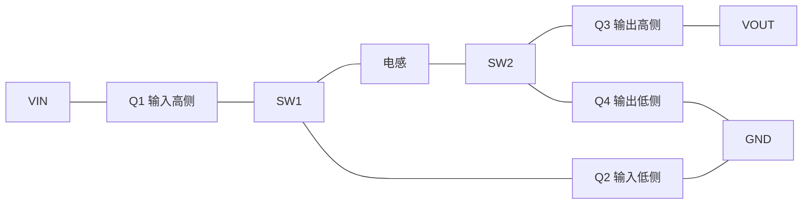

# 硬件资料与原型差异

## 四开关拓扑

Q1/Q2构成输入桥，Q3/Q4构成输出桥；本资料中的Q编号采用此定义。当前v7关闭输出桥门极，正向能量通过Q3体二极管进入输出，不能将其看作四管全同步Buck。

此图为早期设计截图：驱动标UCC27211、自举标100 nF；后续实物有器件替换，图中电解容量未标出。不得据图认定最新实物仍为原BOM。

## 关键器件与版本状态

| 部位 | 资料与记录 | 状态 |
| --- | --- | --- |
| MCU | STM32G474RBTx | 当前固件目标 |
| MOS | 原CJAC80SN10 NL，后报告更换CJAC80SN10 LD | 尚缺本轮装机BOM与封装复核记录 |
| 输入桥驱动 | 原UCC27211，后更换EG27211，用户报告更换后恢复 | 不是完全相同驱动的受控对比实验 |
| 输出桥驱动 | 用户报告仍为TI UCC27211 | v7输出桥门极保持关闭 |
| 驱动供电 | 名义12 V域，历史测得约13 V | 未取得运行中的高频波形 |
| 自举 | 原100 nF，试过200 nF、220 nF，后报告470 nF | 两桥最新实装值、有效容量与耐压待BOM确认 |
| 栅极网络 | 图中10 Ω，并联二极管实现开关速度不对称 | 走线寄生与实际门极波形未测 |
| 电流运放 | 用户提供GS8558-SR | 非独立电感过零/逐周期峰值比较器 |
| 电感 | 测试15 µH；曾试22 µH铁硅铝环形电感 | 22 µH版本的4.2 mΩ不能套用到15 µH |
| 电解 | 4×220 µF，用户提供系列型号EKZN101ELL221MK25S | 120 Hz纹波额定值不能当作200 kHz ESR实测值 |

## 电压、电流采样

图示电压通路为75 kΩ / 3.74 kΩ差分衰减，比例约20.05；固件使用校准/近似比例20.113，两者约0.3%差异，不应直接改成图示值而不复核电阻及仪表。每路输出有100 Ω / 330 pF RC。

输入/输出电流通路：5 mΩ分流、约20倍放大，约0.1 V/A；固件显式减raw3零点。Iin是输入端口观测，不能直接当作电感瞬时电流，不能用数字滤波证明采样点没有受到开关尖峰影响。

输出电容名义总量：

`4×220 + 4×4.7 + 2×1 + 2×0.1 = 901 µF`

实际总容量、MLCC直流偏压降额、ESR及温度影响尚需测量；仿真使用参数范围而非假称已取得完整实测值。

## 待补齐文件

- 全套原理图PDF及EDA源工程，包含MCU、辅源、接口与电压域。
- PCB源文件、Gerber/钻孔、层叠、板厚、铜厚、装配图。
- 与最新实物一致的BOM、器件替换说明、正反面实物照片。
- 电感规格、驱动/自举实装值、散热条件和测量点说明。

当前两张截图不足以独立复刻整板，不能作为完整生产资料包。
