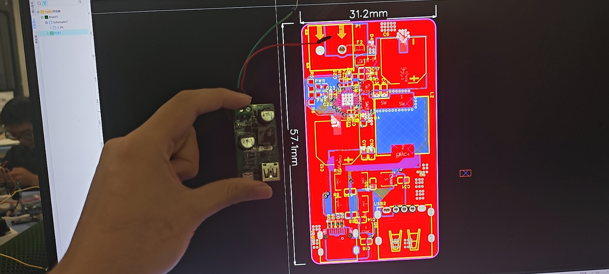
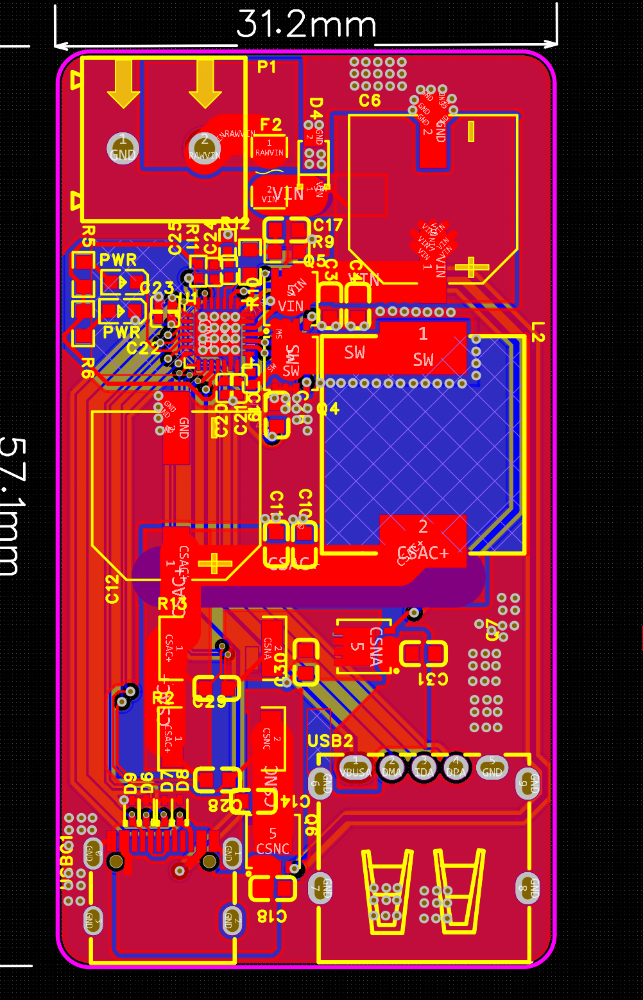
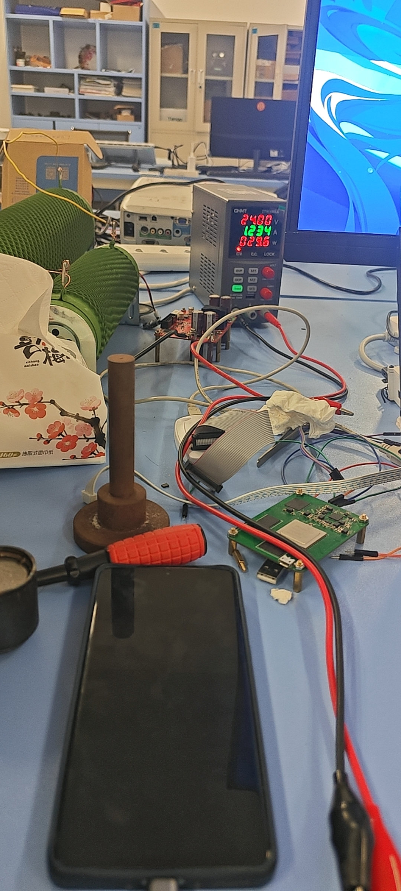
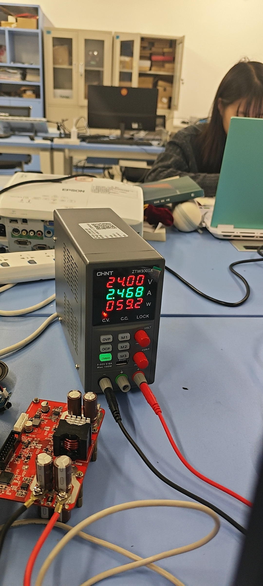
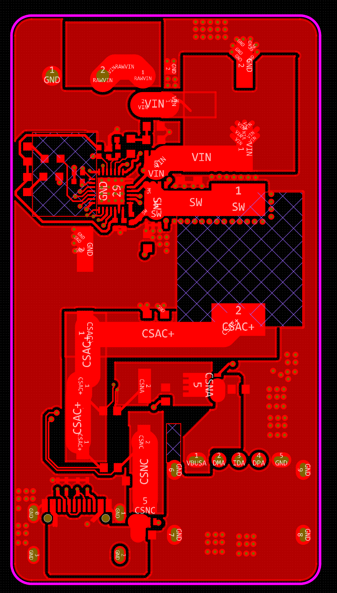
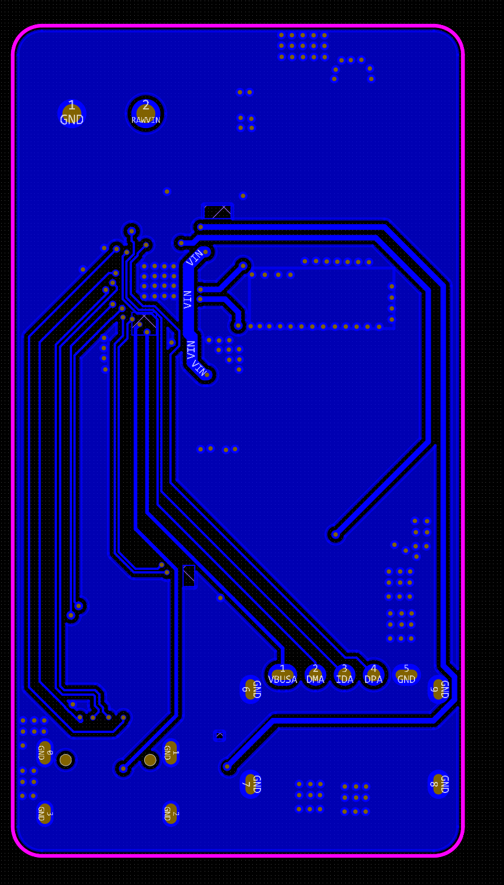

# SW3518S 双口快充供电板

基于 SW3518S 的 USB-A + USB-C 双口快充供电板，PCB 尺寸约 31.2 × 57.1 mm。已完成手机和电脑充电测试。

## 项目概览

| 项目 | 内容 |
| --- | --- |
| 主控 | SW3518S |
| 输出接口 | USB-A + USB-C |
| PCB 尺寸 | 31.2 × 57.1 mm |
| 测试 | 手机充电、电脑 DP 口充电 |

SW3518S 集成同步降压与双口管理，支持 PD、PPS、QC 等快充协议。芯片支持的协议和规格见[智融 SW3518S 数据手册](https://www.ismartware.com/upload/goods/20220829/202208291459438861.pdf)。

## 充电测试

手机充电：电源显示输入 24.00 V、1.234 A，约 29.6 W。

电脑 DP 口充电：电源显示输入 24.00 V、2.468 A，约 59.2 W。

## PCB 布局

## 工程下载

[下载嘉立创 EDA 专业版工程（.epro）](hardware/ProPrj_power-board_2026-10-28.epro?raw=true) · [返回项目列表](../../README.md)
